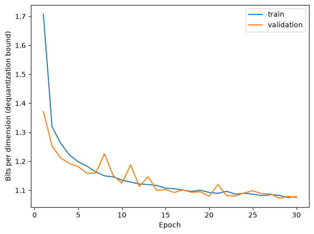
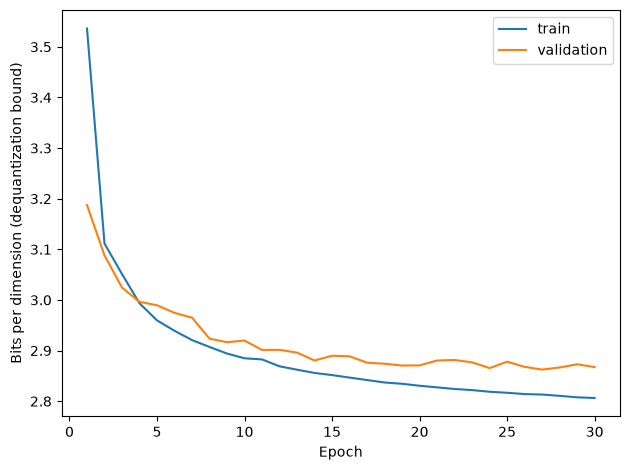
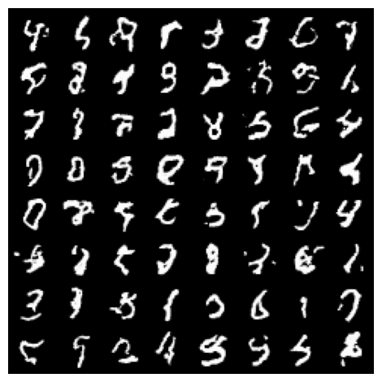
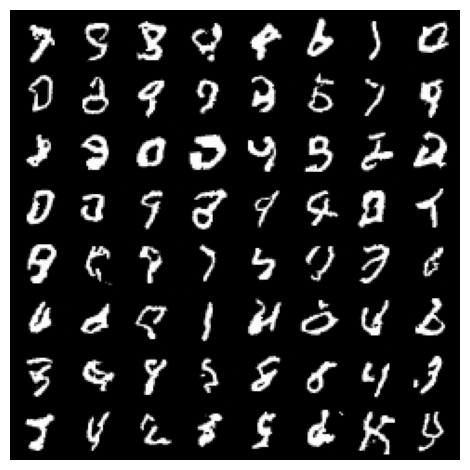
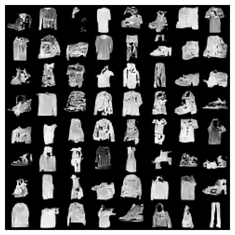
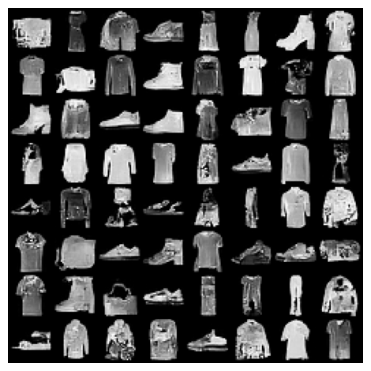
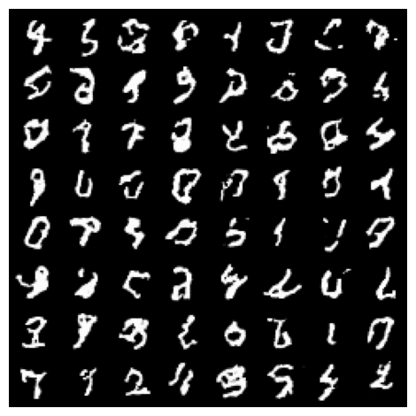

# Normalizing Flows report

> **Norm Flow 5pt.**
>
> Implement RealNVP model and train it on mnist datasets.
>
> - Build the RealNVP architecture (you could extend from lecture example) for grayscale MNIST Digits and MNIST Fashion images
> - Use Coupling Layer and Multi-Scale
> - Implement train loop with validation metrics, evaluate on test set
> - Train the model until it achieves reasonable likelihood and visualize generated samples by inverting the flow.
> - Experiments with hyperparameters or architecture to get nice results of generation. You should try to get somewhat reasonable generation quality for generation.

### Selected models and final test evaluation

| Dataset | Selected epoch | Validation NLL, nats/image | Validation BPD | Test NLL, nats/image | Test BPD |
| --- | ---: | ---: | ---: | ---: | ---: |
| MNIST digits | 28 | 582.9146 | 1.0727 | 580.6333 | **1.0685** |
| Fashion-MNIST | 27 | 1555.5485 | 2.8625 | 1556.5343 | **2.8643** |

### Training curves and generation

The following are the recorded training/validation BPD curves for the selected configurations. They show the entire 30-epoch run.






| MNIST: three-convolution reference, epoch 30 | MNIST: selected five-convolution model, epoch 28 |
| --- | --- |
|  |  |

| Fashion-MNIST: three-convolution reference, epoch 27 | Fashion-MNIST: selected five-convolution model, epoch 27 |
| --- | --- |
|  |  |

Five-convolution results is prefered on both datasets. MNIST digits have more coherent strokes and loops, and Fashion-MNIST contains more recognizable shoe and clothing silhouettes. Ambiguous digits, patchy textures, and malformed items remain.

### Important note

The compact **W=64, C=4, D=3, scale-limit-1** model produced surprisingly good MNIST digit results for its size, with best validation BPD **1.1602 at epoch 30**. It was the preferred configuration at early stage, although its generated digits still included broken strokes and ambiguous shapes. 



Although the small model worked good on digits its performance on fashion dataset was extremely bad. During conversations with my peers I discovered that this small model yeilded results comparable to their results with models with 3-4x each hyperparameter setting. Exausting almost every bit of performance feom smaller model it was desided to double hyperparameters and start work from there.

### Experiment comparisons

All numbers below are best validation BPD from the saved histories. W/C/D means hidden state width / couplings per mask family per scale / convolutions per conditioner.


**MNIST digits** 

| W/C/D | Batch | Learning rate | Scale limit | Alpha | Epochs | Selected epoch | Validation BPD |
| --- | ---: | ---: | ---: | ---: | ---: | ---: | ---: |
| 64/3/3 | 64 | 0.001 | 2 | 1e-5 | 30 | 27 | 1.1942 |
| 96/3/3 | 64 | 0.001 | 2 | 1e-5 | 30 | 27 | 1.1806 |
| 64/4/3 | 64 | 0.001 | 2 | 1e-5 | 30 | 29 | 1.1679 |
| 96/4/3 | 64 | 0.001 | 2 | 1e-5 | 30 | 30 | 1.1575 |
| 64/5/3 | 64 | 0.001 | 2 | 1e-5 | 30 | 29 | 1.1626 |
| 64/3/3 | 64 | 0.001 | 2 | 1e-5 | 60 | 56 | 1.1669 |
| 96/4/3 | 64 | 0.001 | 2 | 1e-5 | 60 | 60 | 1.1340 |
| 64/4/3 | 64 | 0.001 | 1 | 1e-5 | 30 | 30 | 1.1602 |
| 64/4/3 | 64 | 0.0003 | 2 | 1e-5 | 30 | 23 | 1.2034 |
| 64/4/3 | 64 | 0.001 | 2 | 0.01 | 30 | 30 | 1.2771 |
| 64/4/3 | 64 | 0.001 | 1 | 1e-5 | 60 | 55 | 1.1416 |
| 128/8/3 | 256 | 0.001 | 1 | 1e-5 | 30 | 25 | 1.1737 |
| 256/8/3 | 256 | 0.001 | 1 | 1e-5 | 30 | 28 | 1.1598 |
| 128/8/3 | 64 | 0.001 | 1 | 1e-5 | 30 | 30 | 1.1056 |
| 128/8/3 | 32 | 0.001 | 1 | 1e-5 | 30 | 29 | 1.1100 |
| 128/8/3 | 64 | 0.0005 | 1 | 1e-5 | 30 | 27 | 1.1116 |
| 128/8/3 | 64 | 0.001 | 0.5 | 1e-5 | 30 | 25 | 1.1108 |
| 128/8/5 | 64 | 0.001 | 1 | 1e-5 | 30 | 28 | 1.0727 |

**Fashion-MNIST** 

The MNIST-selected settings were transferred to Fashion-MNIST and compared with earlier smaller/larger configurations.

| W/C/D | Batch | Learning rate | Scale limit | Alpha | Epochs | Selected epoch | Validation BPD |
| --- | ---: | ---: | ---: | ---: | ---: | ---: | ---: |
| 64/4/3 | 64 | 0.001 | 1 | 1e-5 | 30 | 29 | 3.0733 |
| 256/8/3 | 256 | 0.001 | 1 | 1e-5 | 30 | 30 | 3.0184 |
| 128/8/3 | 64 | 0.001 | 1 | 1e-5 | 30 | 27 | 2.9514 |
| 128/8/5 | 64 | 0.001 | 1 | 1e-5 | 30 | 27 | 2.8625 |

The further experiments on deep networks were not performed due to the increase in training time.

| Dataset | Three-convolution logged epoch time | Five-convolution logged epoch time |
| --- | ---: | ---: |
| MNIST digits | 35.5 min | 86.2 min |
| Fashion-MNIST | 35.9 min | 85.8 min |

The [artifact index](artifacts/index.md) links the copied configurations, histories, original summaries, sample grids, and loss plots for **all 23 runs**. [CSV](artifacts/experiment_metrics.csv) and [JSON](artifacts/experiment_metrics.json) exports retain unrounded metrics, recorded timings, and the source of each test result. Original checkpoint directory contains full results for 3 selected runs at [best_results](checkpoints\best_results).

All assets can be regenerated without training using:

```sh
uv run --locked python homeworks/01_normalizing_flows/build_report_artifacts.py
```

## What worked well

- The compact digit model was unexpectedly competitive for its size. W=64, C=4, scale limit 1 achieved 1.1602 validation BPD showed surprusingly good results compared with my peers.
- The optimization setup mattered. At W=128, C=8, D=3, reducing batch size from 256 to 64 improved validation BPD from 1.1737 to 1.1056. At 30 epochs, this also increased optimizer updates from 6,330 to 25,320, so the benefit cannot be attributed solely to gradient noise or batch size itself.
- Scale limit 1 was a useful setting. At W=64, C=4, D=3 it improved validation BPD from 1.1679 to 1.1602 and was visually preferred to scale limit 2.
- Stronger conditioners improved both datasets. Adding convolution layers greatly improved the generative performace.

## What did not work as expected

- Increasing width and coupling count while using batch 256 did not immediately produce a clear MNIST improvement. The W=256, C=8 model reached 1.1598 BPD, almost the same as the much smaller scale-1 W=64, C=4 model at 1.1602, while taking substantially longer.
- Further reducing batch size from 64 to 32 did not improve the best W=128, C=8, D=3 validation result. Lowering its learning rate to 0.0005 or its scale limit to 0.5 also failed to beat the 1.1056 reference within 30 epochs.
- At W=64, C=4, D=3, learning rate 0.0003 and logit alpha 0.01 showed worse results.
- Longer training sometimes produced less preferred grids despite better  validation likelihood. For example, W=96, C=4 at 60 epochs reached 1.1340  versus 1.1575 at 30.
- Even the selected models generate malformed digits or clothing details.

## Possible explanations for limitations

- The original shallow conditioners may have had insufficient capacity or  spatial context to coordinate strokes and clothing structure. The deeper  variant supports this direction, but its larger receptive field and parameter increase were not separated experimentally.
- Larger batches give fewer optimizer steps per epoch. A larger model trained with batch 256 may have been less optimized at the same epoch budget. The batch 64 rerun supports this explanation without separating update count from other batch-size effects.
- The likelihood objective does not directly measure whether an image looks like a convincing digit or garment. Better BPD can coexist with undesirable samples. Fixed learning rates may also contribute to validation fluctuations, but no scheduling experiment was performed.

## Potential improvements

1. Test a learning-rate schedule while keeping architecture and epoch budget fixed. 
2. Compare additional conditioner designs, such as residual blocks, against the selected five-convolution reference. 
3. Review several fixed sampling seeds and add measured class coverage, readability, or nearest-neighbor checks for copying before making stronger claims about diversity and memorization. Use validation for further model selection and reserve new test evaluation for a finalized configuration.
