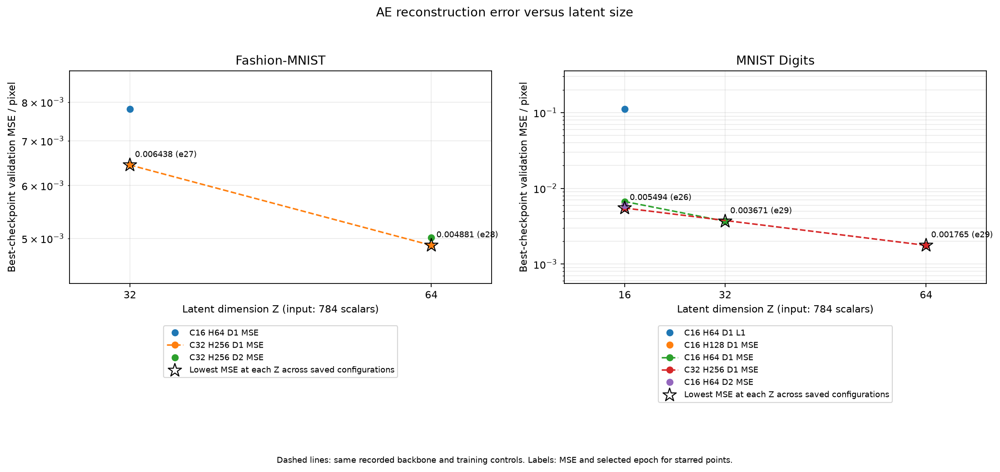
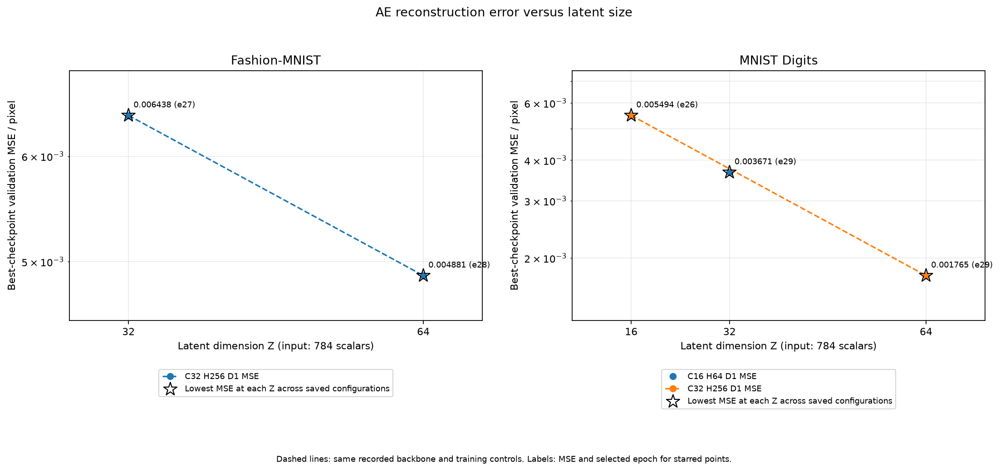
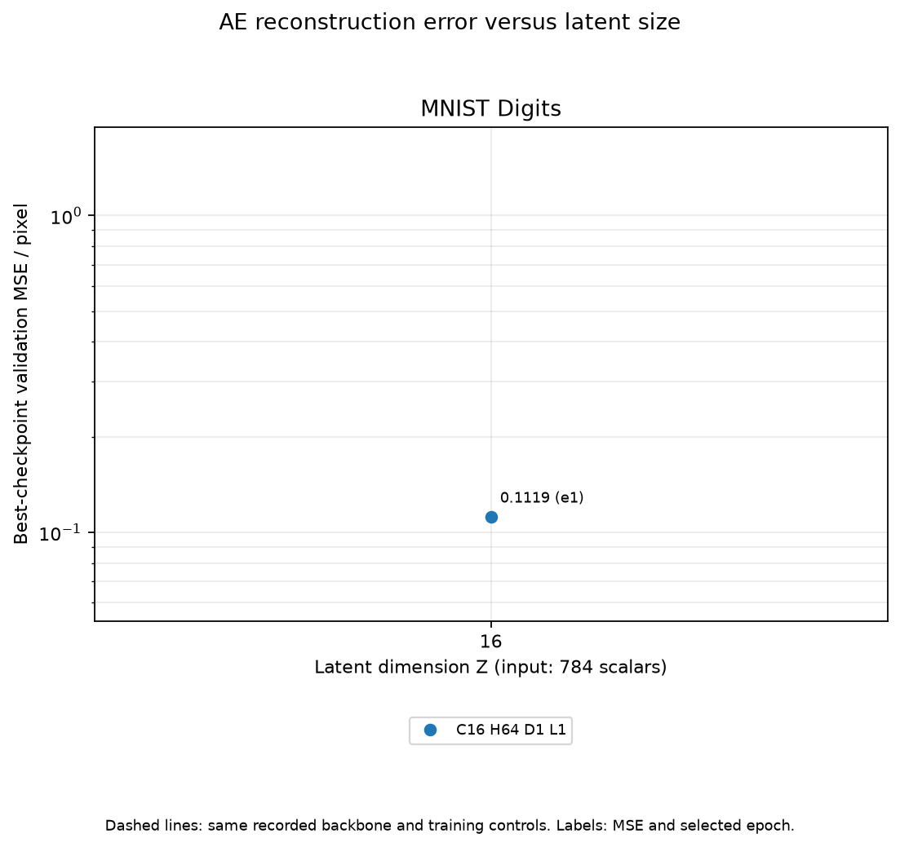
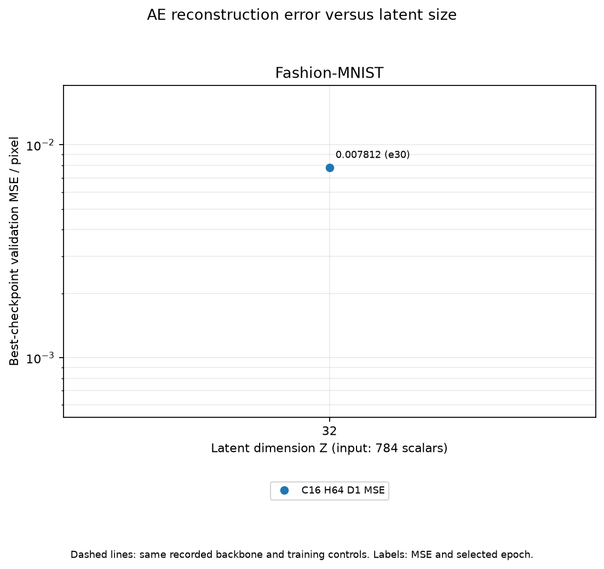
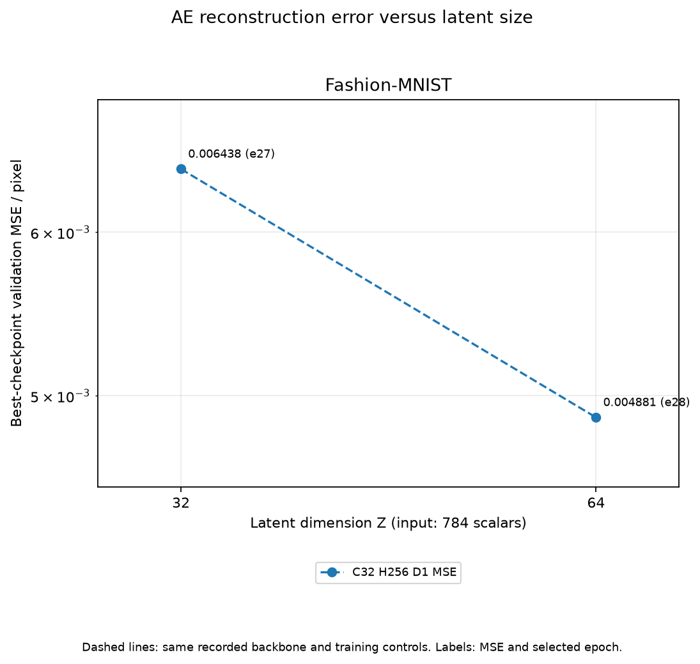
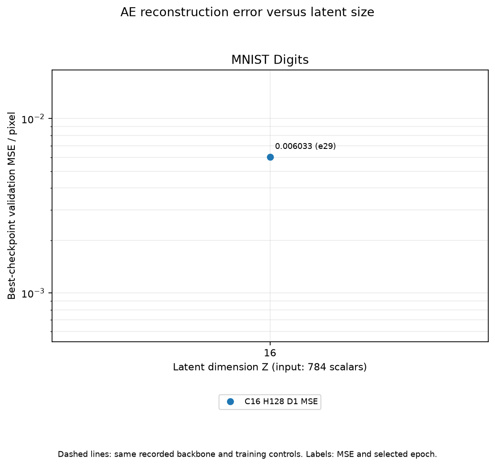
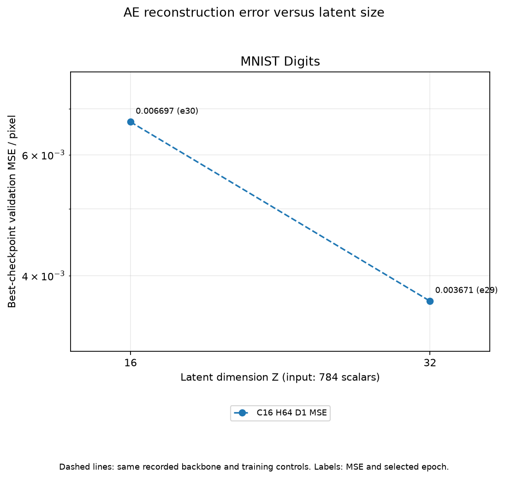
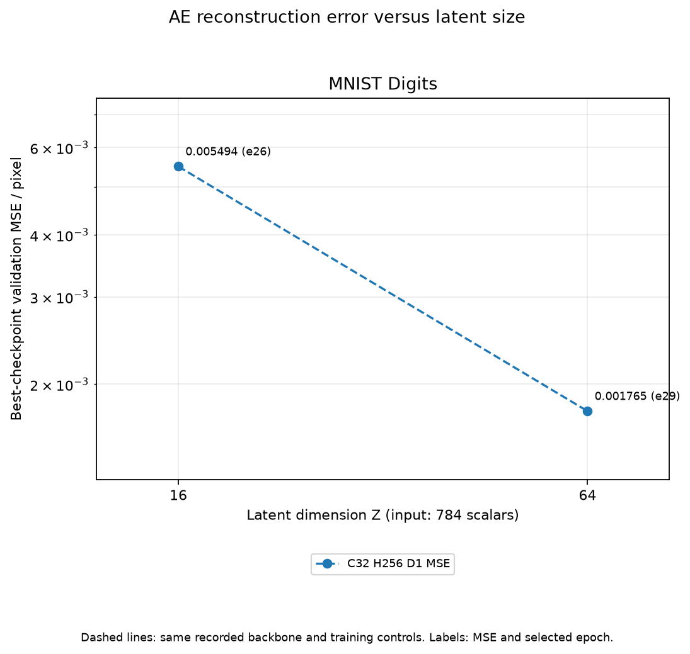
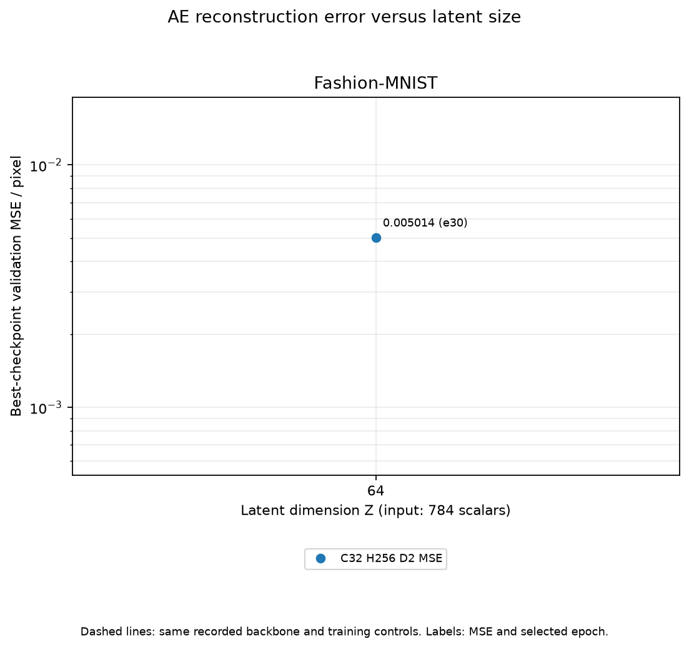

# AE reconstruction error versus latent size

Generated from existing config.json and summary.json files only. No training, inference, downloads, or checkpoint changes were performed.

Each point is per-pixel grayscale validation MSE at the run's best checkpoint. Epoch labels identify that checkpoint; the official test set is not used. Lower is better. Positive MSE is displayed on a logarithmic axis. Overview labels identify starred best points; individual configuration figures label every point.

## Best saved result at each latent size

These selections can change backbone and objective between latent sizes. They describe the best available configurations, not the isolated effect of Z.

| Dataset | Z | Scalar ratio 784/Z | Backbone / loss | Best epoch | Validation MSE | Source run |
| --- | ---: | ---: | --- | ---: | ---: | --- |
| fashion_mnist | 32 | 24.50:1 | C32 H256 D1 MSE | 27 | 0.00643812 | ae_fashion_mnist_z32_c32_h256_d1_e30 |
| fashion_mnist | 64 | 12.25:1 | C32 H256 D1 MSE | 28 | 0.00488076 | ae_fashion_mnist_z64_c32_h256_d1_e30 |
| mnist | 16 | 49.00:1 | C32 H256 D1 MSE | 26 | 0.00549405 | ae_mnist_z16_c32_d1_base_e30 |
| mnist | 32 | 24.50:1 | C16 H64 D1 MSE | 29 | 0.00367136 | ae_mnist_z32_c16_h64_d1_e30 |
| mnist | 64 | 12.25:1 | C32 H256 D1 MSE | 29 | 0.00176530 | ae_mnist_z64_c32_h256_d1_e30 |

The scalar ratio is not a file-size or bitrate measurement.

## Comparisons with matching recorded controls

Each configuration has its own figure, including configurations with only one Z. A single point cannot establish a latent-size trend. Additional training at other Z values would be needed for those configurations; none was launched.

### G01: mnist / C16 H64 D1 L1

Z = 16; single measured latent size; more runs needed for a curve.

- [ae_mnist_z16_c16_h64_d1_l1_e30](../../../../checkpoints/vae/ae_mnist_z16_c16_h64_d1_l1_e30/summary.json): Z16, epoch 1, MSE 0.11186010; [reconstructions](../../../../checkpoints/vae/ae_mnist_z16_c16_h64_d1_l1_e30/reconstructions_best.png).

### G02: fashion_mnist / C16 H64 D1 MSE

Z = 32; single measured latent size; more runs needed for a curve.

- [ae_fashion_mnist_z32_c16_h64_d1_e30](../../../../checkpoints/vae/ae_fashion_mnist_z32_c16_h64_d1_e30/summary.json): Z32, epoch 30, MSE 0.00781166; [reconstructions](../../../../checkpoints/vae/ae_fashion_mnist_z32_c16_h64_d1_e30/reconstructions_best.png).

### G03: fashion_mnist / C32 H256 D1 MSE

Z = 32, 64; measured latent-size comparison.

- [ae_fashion_mnist_z32_c32_h256_d1_e30](../../../../checkpoints/vae/ae_fashion_mnist_z32_c32_h256_d1_e30/summary.json): Z32, epoch 27, MSE 0.00643812; [reconstructions](../../../../checkpoints/vae/ae_fashion_mnist_z32_c32_h256_d1_e30/reconstructions_best.png).
- [ae_fashion_mnist_z64_c32_h256_d1_e30](../../../../checkpoints/vae/ae_fashion_mnist_z64_c32_h256_d1_e30/summary.json): Z64, epoch 28, MSE 0.00488076; [reconstructions](../../../../checkpoints/vae/ae_fashion_mnist_z64_c32_h256_d1_e30/reconstructions_best.png).

### G04: mnist / C16 H128 D1 MSE

Z = 16; single measured latent size; more runs needed for a curve.

- [ae_mnist_z16_c16_h128_d1_e30](../../../../checkpoints/vae/ae_mnist_z16_c16_h128_d1_e30/summary.json): Z16, epoch 29, MSE 0.00603301; [reconstructions](../../../../checkpoints/vae/ae_mnist_z16_c16_h128_d1_e30/reconstructions_best.png).

### G05: mnist / C16 H64 D1 MSE

Z = 16, 32; measured latent-size comparison.

- [ae_mnist_z16_c16_h64_d1_e30](../../../../checkpoints/vae/ae_mnist_z16_c16_h64_d1_e30/summary.json): Z16, epoch 30, MSE 0.00669650; [reconstructions](../../../../checkpoints/vae/ae_mnist_z16_c16_h64_d1_e30/reconstructions_best.png).
- [ae_mnist_z32_c16_h64_d1_e30](../../../../checkpoints/vae/ae_mnist_z32_c16_h64_d1_e30/summary.json): Z32, epoch 29, MSE 0.00367136; [reconstructions](../../../../checkpoints/vae/ae_mnist_z32_c16_h64_d1_e30/reconstructions_best.png).

### G06: mnist / C32 H256 D1 MSE

Z = 16, 64; measured latent-size comparison.

- [ae_mnist_z16_c32_d1_base_e30](../../../../checkpoints/vae/ae_mnist_z16_c32_d1_base_e30/summary.json): Z16, epoch 26, MSE 0.00549405; [reconstructions](../../../../checkpoints/vae/ae_mnist_z16_c32_d1_base_e30/reconstructions_best.png).
- [ae_mnist_z64_c32_h256_d1_e30](../../../../checkpoints/vae/ae_mnist_z64_c32_h256_d1_e30/summary.json): Z64, epoch 29, MSE 0.00176530; [reconstructions](../../../../checkpoints/vae/ae_mnist_z64_c32_h256_d1_e30/reconstructions_best.png).

### G07: fashion_mnist / C32 H256 D2 MSE

Z = 64; single measured latent size; more runs needed for a curve.

- [ae_fashion_mnist_z64_c32_h256_d2_e30](../../../../checkpoints/vae/ae_fashion_mnist_z64_c32_h256_d2_e30/summary.json): Z64, epoch 30, MSE 0.00501441; [reconstructions](../../../../checkpoints/vae/ae_fashion_mnist_z64_c32_h256_d2_e30/reconstructions_best.png).

### G08: mnist / C16 H64 D2 MSE

Z = 16; single measured latent size; more runs needed for a curve.

- [ae_mnist_z16_c16_h64_d2_e30](../../../../checkpoints/vae/ae_mnist_z16_c16_h64_d2_e30/summary.json): Z16, epoch 30, MSE 0.00600290; [reconstructions](../../../../checkpoints/vae/ae_mnist_z16_c16_h64_d2_e30/reconstructions_best.png).

## Interpretation limits

- Line segments only join observed points; missing latent sizes are not estimated.
- Fixed-control groups separate MSE/L1 objectives, seeds, training settings and backbones.
- These runs do not provide independent training repeats or uncertainty estimates.
- The L1 run remains included, even though its MSE is much worse.
