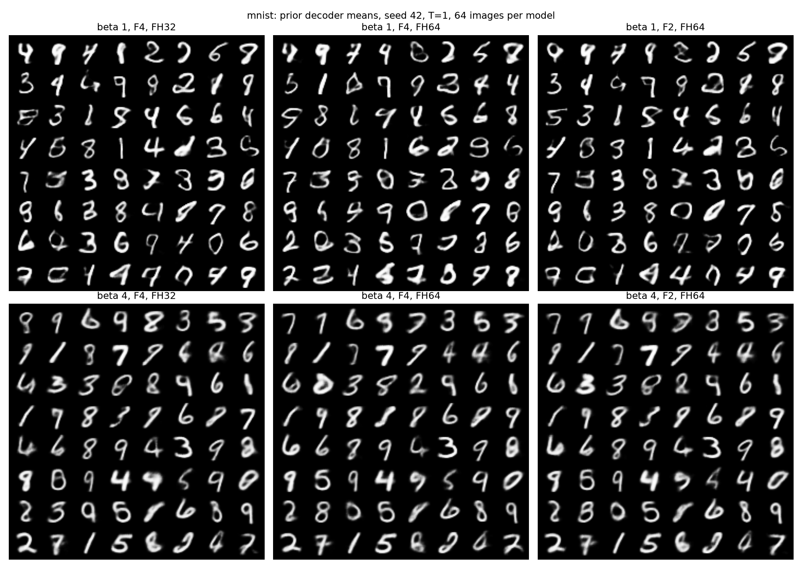
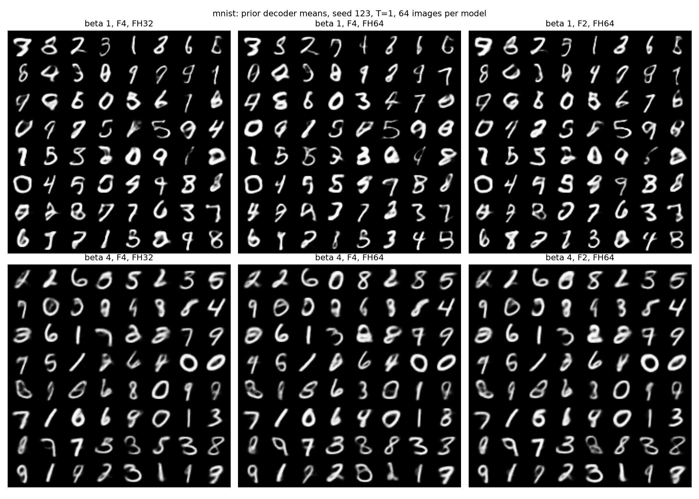
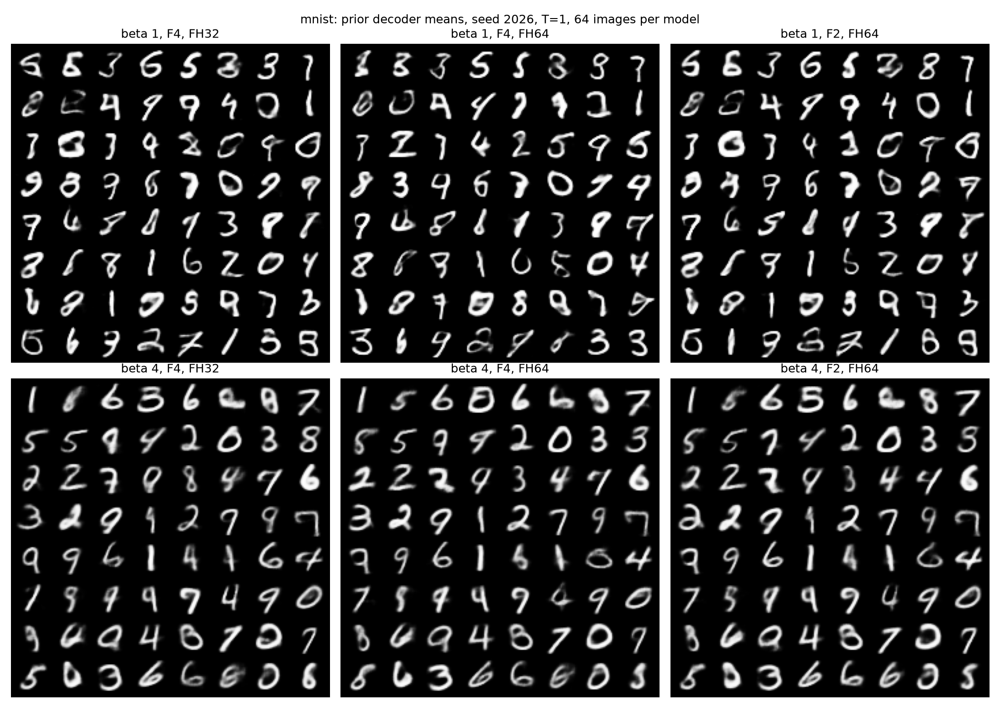
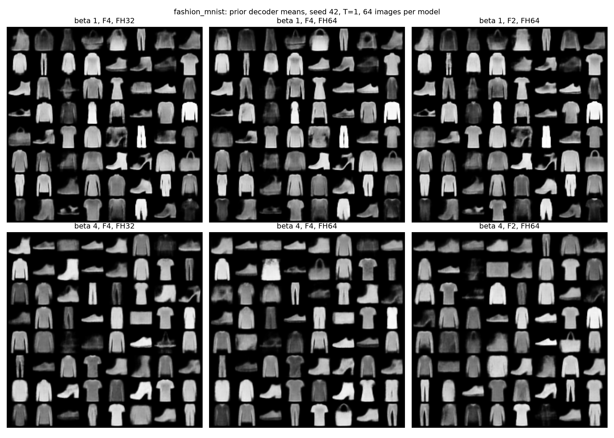
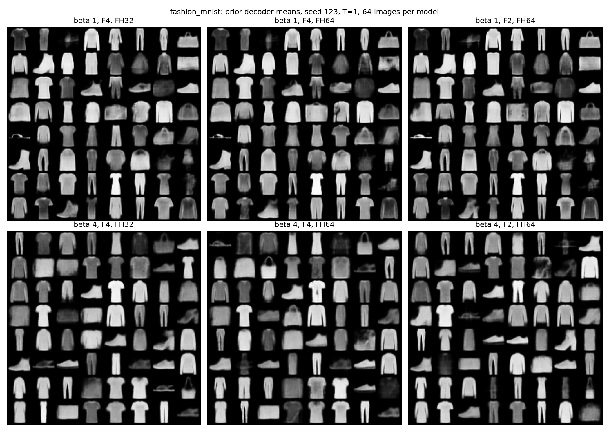
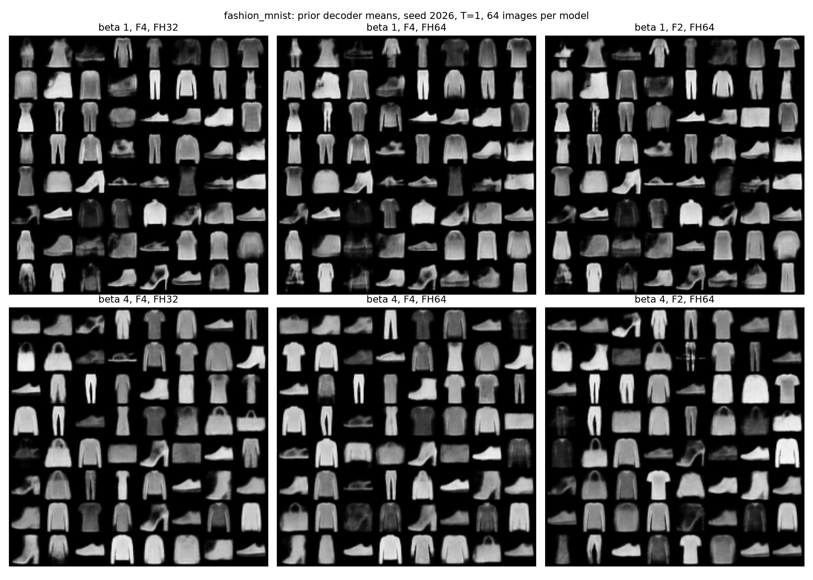

# f-VAE dataset and beta comparison

Requested matrix: F4/FH32, F4/FH64 and F2/FH64 on MNIST with beta1, then Fashion-MNIST with beta1 and beta4. One matching completed MNIST beta1 run was reused; eight new runs were trained sequentially. Existing MNIST beta4 runs are included as comparison context, without retraining.

Fixed: Z32 C32 H256 D1, two hidden layers per flow conditioner, scale limit 1, Bernoulli likelihood with dynamic binarization, 30 epochs, batch 64, Adam lr 0.001, seed 42. Splits are 54,000 train / 6,000 validation per dataset. No downloads or official test evaluation were performed.

Validation checkpoint selection minimizes ordinary negative ELBO, even for beta4. The training objective uses the specified beta. Negative ELBO is an estimated bound, not exact marginal NLL; likelihood and KL units are nats/image. Grayscale MSE is a per-pixel diagnostic against original grayscale targets, with binarized encoder inputs.

## Measurements

| Dataset | Beta | F | FH | Parameters | Best epoch | Negative ELBO | Recon NLL | KL | MSE |
|---|---:|---:|---:|---:|---:|---:|---:|---:|---:|
| mnist | 1 | 4 | 32 | 1,717,505 | 28 | 90.7509 | 65.2560 | 25.4949 | 0.010860 |
| mnist | 1 | 4 | 64 | 1,742,337 | 30 | 90.5943 | 64.9363 | 25.6580 | 0.010810 |
| mnist | 1 | 2 | 64 | 1,721,473 | 27 | 90.8676 | 64.9533 | 25.9143 | 0.010847 |
| mnist | 4 | 4 | 32 | 1,717,505 | 30 | 106.6972 | 96.1238 | 10.5735 | 0.021322 |
| mnist | 4 | 4 | 64 | 1,742,337 | 30 | 107.2591 | 96.8269 | 10.4322 | 0.021602 |
| mnist | 4 | 2 | 64 | 1,721,473 | 30 | 106.8673 | 96.2949 | 10.5724 | 0.021401 |
| fashion_mnist | 1 | 4 | 32 | 1,717,505 | 30 | 232.8148 | 215.9051 | 16.9097 | 0.014474 |
| fashion_mnist | 1 | 4 | 64 | 1,742,337 | 30 | 232.7821 | 215.9783 | 16.8038 | 0.014498 |
| fashion_mnist | 1 | 2 | 64 | 1,721,473 | 30 | 232.9599 | 216.1504 | 16.8095 | 0.014550 |
| fashion_mnist | 4 | 4 | 32 | 1,717,505 | 28 | 243.8420 | 236.6915 | 7.1505 | 0.021474 |
| fashion_mnist | 4 | 4 | 64 | 1,742,337 | 29 | 244.0994 | 237.0055 | 7.0939 | 0.021687 |
| fashion_mnist | 4 | 2 | 64 | 1,721,473 | 28 | 243.8159 | 236.6826 | 7.1333 | 0.021476 |

## Generation comparisons

Rows show beta1 and beta4; columns show F4/FH32, F4/FH64 and F2/FH64. Each panel contains 64 prior decoder means at temperature 1. The three sampling seeds are inference repeats, not independent training runs. Latent coordinate meanings can differ across trained models; corresponding cells are not guaranteed to represent the same digit/class.

## Assessment

All three layouts are closely grouped within each dataset/beta setting. For MNIST beta1, F4/FH64 has the lowest recorded negative ELBO (90.5943); F4/FH32 and F2/FH64 are close at 90.7509 and 90.8676. For Fashion-MNIST beta1, F4/FH64 is lowest at 232.7821, but F4/FH32 (232.8148) and F2/FH64 (232.9599) are effectively close in this single-seed comparison. For Fashion-MNIST beta4, F2/FH64 (243.8159) and F4/FH32 (243.8420) are nearly tied, with F4/FH64 at 244.0994. Beta1 gives better ordinary ELBO and reconstruction MSE than beta4 in this common Bernoulli protocol. Across the inspected prior grids at seeds 42, 123 and 2026, the three architectures have broadly similar recognizable shapes within a beta setting; no clear general generation winner is established by conditioner width or coupling count. On MNIST, beta4 generally makes digit shapes softer and simpler, while beta1 retains sharper and more varied stroke styles, including some ambiguous shapes. The earlier preference for beta4 concerned coherence rather than an objective or universal improvement. On Fashion-MNIST, beta1 retains more visible variation and structure; beta4 gives smoother, more generic clothing silhouettes. Fine textures remain weak in both. Changing beta has a larger observed visual and metric effect than the small flow layout changes. F2 is a reasonable economical candidate, with no compelling visible disadvantage in these grids; the small metric differences should not be treated as statistically established rankings. The three inference seeds are not independent training repeats. No new training beyond the eight missing configurations was performed; one requested configuration and three contextual MNIST beta4 models were reused.

## Generation diversity and latent traversals

The [qualitative diversity and traversal review](diversity_and_traversals.md)
examines the saved three-seed generation grids and the first eight prior-coordinate
traversals of the matched F4/FH64 models at beta1 and beta4 on both datasets.
Both weights retain broad visible category variety. beta1 generally retains more
appearance detail and variation. The traversals show meaningful changes, but
identity/category, geometry and brightness often change together; beta4 does not
establish clearer separation. Several coordinates have little visible effect near
the zero anchor. This local sensitivity check is not a global disentanglement or
posterior-activity measurement. No new training or inference was performed.

## Verification and provenance

The Fashion-MNIST CUDA forward smoke check passed with finite objectives before training. All recorded histories have 30 epochs and finite metrics. Configurations were checked against the frozen reference. All comparison checkpoints loaded successfully. Reused checkpoint and README hashes were verified unchanged. Model implementations and dependencies were not modified.

[Manifest and exact commands](manifest.json), [metrics CSV](metrics.csv), [metrics JSON](metrics.json), [validation curves](validation_curves.png), [sample metadata](sample_metadata.json). Individual training logs and inference grids are saved in this directory. Each training run retains its best checkpoint, full configuration, histories, reconstruction grids, prior samples and traversals.

Comparisons use one training seed per setting. Visual preferences are qualitative and no FID/classifier-based ranking is claimed. Seeds alone do not guarantee bitwise reproducibility under nondeterministic CUDA operations.
