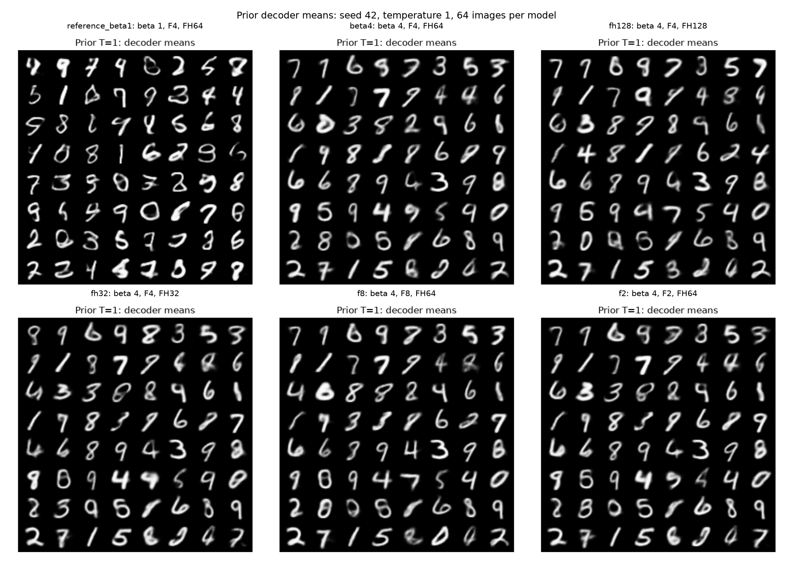
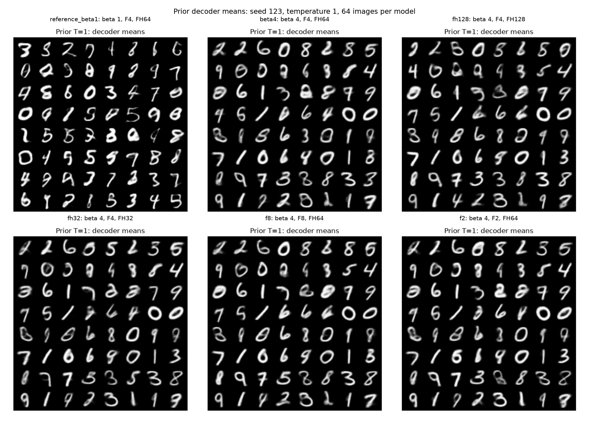
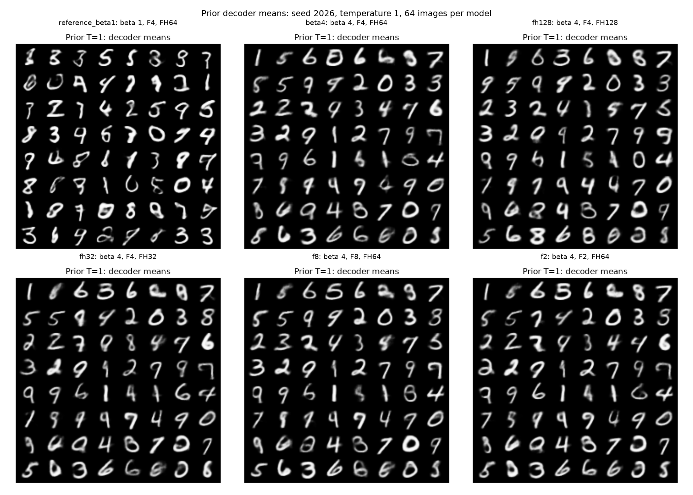

# Controlled MNIST f-VAE experiments

Five new runs were authorized and trained sequentially, in the requested order. The existing beta1 run was reused as reference.

Fixed settings: Z32 C32 H256 D1, Bernoulli likelihood with dynamic binarization, 30 epochs, batch 64, Adam lr 0.001, seed 42, scale limit 1, two hidden layers per flow conditioner. Splits: 54,000 train / 6,000 validation; the official test set was not evaluated.

After choosing beta, FH128/FH32 use F4 and F8/F2 use FH64. No changes were made to model implementations, dependency versions, or README. The reference checkpoint SHA256 was verified unchanged.

## Beta decision

Chosen beta: **4**.

Across the inspected seeds, beta4 generally produces simpler and more coherent/readable digits with fewer fragmented or malformed shapes. It is softer and sacrifices some stroke/style detail. Both settings retain visibly varied digit shapes. Prefer beta4 for generation; this is a visual assessment, not a statistically established ranking.

This choice concerns the inspected generation grids. Beta4 has a worse ordinary negative ELBO and worse reconstruction MSE than beta1; it is not a likelihood improvement.

## Measurements

Validation metrics are from the checkpoint minimizing ordinary negative ELBO. Likelihood/KL terms are nats/image; grayscale MSE is per pixel. The beta-weighted objective is logged separately and must not be compared directly across beta values. Negative ELBO is a Monte Carlo estimate, not exact marginal NLL.

| Experiment | Beta | F | FH | Parameters | Best epoch | Negative ELBO | Recon NLL | KL | MSE |
|---|---:|---:|---:|---:|---:|---:|---:|---:|---:|
| reference_beta1 | 1 | 4 | 64 | 1,742,337 | 30 | 90.5943 | 64.9363 | 25.6580 | 0.010810 |
| beta4 | 4 | 4 | 64 | 1,742,337 | 30 | 107.2591 | 96.8269 | 10.4322 | 0.021602 |
| fh128 | 4 | 4 | 128 | 1,816,577 | 23 | 107.3028 | 96.8078 | 10.4950 | 0.021608 |
| fh32 | 4 | 4 | 32 | 1,717,505 | 30 | 106.6972 | 96.1238 | 10.5735 | 0.021322 |
| f8 | 4 | 8 | 64 | 1,784,065 | 30 | 107.1133 | 96.6983 | 10.4150 | 0.021577 |
| f2 | 4 | 2 | 64 | 1,721,473 | 30 | 106.8673 | 96.2949 | 10.5724 | 0.021401 |

## Fixed-seed comparisons

Each model was inspected at three inference seeds (42, 123, 2026), 64 prior draws per seed, temperature 1. Images show decoder means without observation noise. These are inference repeats, not independent training seeds; visual preferences are qualitative, not measured FID/classifier scores.

## Assessment

Across seeds 42, 123 and 2026, the beta4 variants have broadly similar digit readability and softness. FH128 and F8 do not show a convincing visual generation advantage over F4/FH64. F4/FH32 has the lowest measured negative ELBO (106.6972) and grayscale MSE (0.021322) within the beta4 group. F2/FH64 is close (negative ELBO 106.8673), with similar-looking samples and the shortest recorded training time. These are useful candidates, not a statistically established generation ranking: each configuration has one training seed. The three inference seeds do not substitute for independent training repeats. Beta4 remains the qualitative generation choice for its generally simpler, more coherent shapes, with softer edges and worse reconstruction/ordinary ELBO than the beta1 reference. No further training was authorized or launched after the five specified runs.

## Verification and files

Three synthetic CUDA optimizer tests passed before training. All six reference/new run histories have 30 epochs and finite recorded metrics. Fixed configurations and the reference checkpoint hash were checked. Each new run has best.pt, config.json, history.json, summary.json, loss curves, prior grids, reconstruction grids, and latent traversals.

Exact commands, source paths, beta decision and completion state: [manifest.json](manifest.json). Measured metrics: [CSV](metrics.csv), [JSON](metrics.json). Comparison curves: [validation_comparison.png](validation_comparison.png). The runner and inference exporter are retained in this directory with individual training logs.

No additional training beyond the five requested experiments was performed. Seeds alone do not guarantee bitwise reproducibility with nondeterministic CUDA operations.
