# Autoencoders and VAE report

> **VAE ? 10pt. (+2pt. optional)**
>
> Autoencoder Compression:
> - Implement a simple autoencoder for the MNIST datasets.
> - Train it to compress and reconstruct input images.
> - Experiment with different latent (hidden) sizes to analyze their effect on reconstruction quality and compression error.
> - Plot the reconstruction error vs. latent size and visualize sample reconstructions for comparison
>
> Variational Autoencoder (VAE):
> - Implement a VAE for both MNIST Digits and Fashion-MNIST datasets.
> - Train the model to achieve reasonable reconstruction quality and likelihood.
> - Visualize generated samples by sampling from the latent space.
> - Compare results between MNIST Digits and Fashion-MNIST.
>
> f-VAE:
> - Use VAE and RealNVP to implement NF inside VAE latent space
> - Train the model to achieve reasonable reconstruction quality and likelihood.
> - Visualize generated samples by sampling from the latent space.
>
> Bonus (optional): β-VAE Exploration (2pt.)
> - Implement a β-VAE variant by adjusting the KL divergence weight (β).
> - Explore how varying β affects:
>     - Latent space disentanglement
>     - Reconstruction quality
>     - Generation diversity
> - Visualize the effect of changing individual latent dimensions on generated images.

## Implementation and experimental setup

### Models and architecture

The implementation contains a deterministic autoencoder (AE), a variational
autoencoder (VAE), and a flow-based VAE (f-VAE). The model definitions are in
[models.py](../../src/vae/models.py), the latent RealNVP flow in
[latent.py](../../src/vae/latent.py), and the losses in
[objectives.py](../../src/vae/objectives.py). Training and evaluation are separate
from the architectures in [train.py](../../src/vae/train.py),
[training.py](../../src/vae/training.py), and [evaluate.py](../../src/vae/evaluate.py).

The experiments use the notation **Z/C/H/D**: latent dimension / first convolution
width / dense feature width / convolution depth per resolution stage. The encoder
has two stride-2 convolution stages, reducing 28 x 28 images to 14 x 14 and then
7 x 7 feature maps, with channel widths C and 2C. A dense layer maps these features
to H units. The decoder mirrors the structure with transposed convolutions.
Activations are SiLU, with sigmoid output means. D=1 is the basic two-stage
backbone; larger D adds 3 x 3 stride-1 convolutions within each stage.

The AE maps each image to a deterministic Z-dimensional vector. It learns
compression and reconstruction, but has no fitted latent prior for unconditional
generation. The VAE predicts a diagonal-Gaussian posterior mean and log variance
and uses reparameterization, `z0 = mean + exp(0.5 * log_variance) * epsilon`, with
`epsilon ~ N(0,I)`. Log variance is bounded to [-12,12]. Generation samples the
standard Gaussian prior and decodes it.

The f-VAE transforms posterior samples using alternating masked affine RealNVP
couplings, reusing [AffineCoupling](../../src/flows/coupling.py) from Task 1. **F**
is the number of latent coupling transformations and **FH** their conditioner
hidden width. Each conditioner has two hidden layers, with scale limit 1. The
flow preserves Z dimensions and changes the posterior density according to
`log qK = log q0 - log|det(dzK/dz0)|`. The prior remains standard Gaussian;
generation decodes prior draws directly, without passing through the posterior
flow. The optional beta weight is available for both VAE and f-VAE.

### Data, optimization and measurement conventions

Both MNIST Digits and Fashion-MNIST use **54,000 training / 6,000 validation /
10,000 held-out test images**, obtained by a seeded split of the official 60,000
training examples. Labels are ignored. Full experiments use Adam, learning rate
0.001, batch size 64 and seed 42, normally for 30 epochs. One Fashion Gaussian VAE
was also trained for 60 epochs. There is no scheduler, dropout, batch normalization
or KL warm-up. The recorded device is an NVIDIA GeForce RTX 4060 Laptop GPU.
Python, NumPy and PyTorch seeds are set, but the CUDA runs do not guarantee
bitwise reproducibility.

The AE uses original grayscale images in [0,1]. Its default objective is squared
error summed over 784 pixels, then averaged over the batch. Reported **MSE** is
per-pixel grayscale error, so the objective equals 784 times MSE. An L1 experiment
instead minimizes summed absolute error; its checkpoint is still selected by
validation MSE. A ratio 784/Z describes input scalars per latent scalar, not a
compressed-file byte ratio or an entropy-coded bitrate.

VAE and f-VAE experiments use two observation models:

- **Bernoulli:** input and target are the same dynamically binarized image. The
  reconstruction NLL uses binary cross-entropy with logits.
- **Gaussian:** input and target retain the original grayscale values. The
  observation standard deviation is fixed at 0.1, with all Gaussian normalization
  constants included in the reconstruction NLL.

The optimized variational objective is reconstruction NLL + beta * KL. The plain
VAE uses analytic Gaussian KL; f-VAE estimates KL with `log qK - log p(zK)`.
Reconstruction and KL sum across pixels/latent dimensions before batch averaging.
The ordinary **negative ELBO = reconstruction NLL + KL** is logged separately and
selects checkpoints, including when beta differs from 1. All likelihood terms in
this report are nats/image. Negative ELBO is a bound estimate, not exact marginal
NLL. Gaussian values describe continuous densities and can be negative; their
magnitudes cannot be ranked directly against Bernoulli scores or Task 1 BPD.

AE checkpoint selection minimizes validation MSE. Saved variational MSE is a
reconstruction diagnostic from posterior draws; Bernoulli models receive binarized
inputs, while Gaussian models receive grayscale inputs. Displayed reconstructions
instead decode the encoded base mean, followed by the posterior flow where
applicable. They are illustrative reconstructions rather than the sampled metric
calculation. Prior grids show 64 decoder means at temperature 1. Selected
reconstruction grids contain 24 examples, with eight comparisons per row.

Existing correctness checks cover shapes, reparameterization, KL/likelihood
conventions, finite gradients, flow inversion and Jacobians, checkpoint handling,
and synthetic optimization steps. The [experiment instructions](experiments.md)
record command options and tuning parameters.

## Results and required artifacts

The saved record contains **42 completed runs: 41 full-split experiments and one
three-epoch f-VAE smoke run on 1,024 training / 256 validation examples**. The
smoke result is excluded from the full-data comparisons below. Experiment tables
show selected-checkpoint validation metrics; final-test tables explicitly separate
validation and test measurements. Values are rounded for display. Original
precision, source hashes, configurations, histories and selected figures are in
the [artifact index](artifacts/index.md), [CSV](artifacts/experiment_metrics.csv)
and [JSON](artifacts/experiment_metrics.json).

**Final test evaluation is complete for six selected checkpoints**, covering AE,
VAE and f-VAE on both datasets. The official test sets were not used to choose
architectures, hyperparameters or checkpoint epochs. The final-test section below
reports held-out measurements; the remaining experiment tables retain validation
results. Reference models organize comparisons across different objectives and
do not establish one universal winner for reconstruction, likelihood and generation.

### Final test evaluation

Both steps use the full official 10,000-image test split per dataset. Checkpoints were frozen using validation results before evaluation. CUDA, batch 64, seed 42; variational models use Bernoulli observations, beta=1 and an additional IWAE bound with 32 importance samples. Likelihood terms are nats/image; MSE is per pixel. No retraining was performed.

#### Step 1: top validation performers

**MNIST Digits**

| Model | Z/C/H/D | Epoch | Val MSE | Test MSE | Val negative ELBO | Test negative ELBO | Test negative IWAE-32 |
| --- | --- | --- | --- | --- | --- | --- | --- |
| AE | 64/32/256/1 | 29 | 0.001765 | 0.001733 | n/a | n/a | n/a |
| VAE | 32/64/256/1 | 30 | 0.010893 | 0.010818 | 91.2263 | 90.6115 | 86.1672 |
| f-VAE | 32/32/256/1; F4/FH64 | 30 | 0.010810 | 0.010791 | 90.5943 | 90.0439 | 85.8296 |

**Fashion-MNIST**

| Model | Z/C/H/D | Epoch | Val MSE | Test MSE | Val negative ELBO | Test negative ELBO | Test negative IWAE-32 |
| --- | --- | --- | --- | --- | --- | --- | --- |
| AE | 64/32/256/1 | 28 | 0.004881 | 0.004841 | n/a | n/a | n/a |
| VAE | 32/64/256/1 | 30 | 0.014198 | 0.014148 | 232.7867 | 233.4992 | 230.3982 |
| f-VAE | 32/32/256/1; F4/FH64 | 30 | 0.014498 | 0.014463 | 232.7821 | 233.5651 | 230.7178 |

#### Step 2: matched architectures between datasets

Step 1 already supplies exact cross-dataset architecture matches, including the same likelihood, beta and flow settings. These rows reuse the same six evaluations.

| Model | Identical Z/C/H/D | Parameters per model | Digits test MSE | Fashion test MSE | Digits test negative ELBO | Fashion test negative ELBO |
| --- | --- | --- | --- | --- | --- | --- |
| AE | 64/32/256/1 | 1,708,801 | 0.001733 | 0.004841 | n/a | n/a |
| VAE | 32/64/256/1 | 3,507,137 | 0.010818 | 0.014148 | 90.6115 | 233.4992 |
| f-VAE | 32/32/256/1; F4/FH64 | 1,742,337 | 0.010791 | 0.014463 | 90.0439 | 233.5651 |

Negative ELBO and IWAE are likelihood-bound estimates. AE and variational MSE also differ in observation protocol and deterministic versus sampled reconstruction, so their values do not isolate architecture effects. These test results do not measure generation diversity or disentanglement.

[Full test results, figures and provenance](artifacts/final_test_01/results.md).

Test minus validation negative-ELBO gaps (nats/image) are mnist VAE: -0.6148; mnist f-VAE: -0.5504; fashion_mnist VAE: +0.7125; fashion_mnist f-VAE: +0.7831. The AE test MSEs are also close to their validation values. On Digits the selected f-VAE has a lower test bound than the selected VAE; on Fashion the selected VAE is slightly lower. The image backbones differ between these model families, and only one seed is evaluated, so this does not establish a general flow advantage. Step 2 matches backbones across datasets within each family, not across AE/VAE/f-VAE.

#### Why the AE reconstructs more accurately

The selected AE achieved the lowest test reconstruction MSE: 0.001733 on Digits
and 0.004841 on Fashion. This is consistent with its objective: it devotes its
latent representation entirely to minimizing squared reconstruction error. The
VAE and f-VAE must also pay a KL penalty for departing from the standard Gaussian
prior, limiting how freely they can encode image-specific information.

This experiment also gives the AE a larger bottleneck: Z64 versus Z32 for the
selected variational models. The AE receives original grayscale inputs and is
evaluated deterministically; the Bernoulli VAE/f-VAE receive binarized inputs and
are evaluated using sampled posterior reconstructions. Consequently, the MSE gap
cannot be attributed solely to the model family or the KL term. The Gaussian VAE
experiments improved grayscale reconstruction, but those models were not part of
this Bernoulli final-test selection.

The AE is therefore the reconstruction reference in this comparison, while the
VAE and f-VAE additionally support unconditional generation from a defined prior.
A lower AE reconstruction MSE does not establish better generation: the plain AE
has no fitted sampling prior.

#### Final assessment

The test results broadly preserve the validation findings. On Digits, the selected
f-VAE has lower negative ELBO (90.0439 versus 90.6115) and negative IWAE-32 bound
(85.8296 versus 86.1672) than the selected VAE. On Fashion, the selected VAE is
slightly lower at 233.4992 versus 233.5651 negative ELBO, and 230.3982 versus
230.7178 negative IWAE-32. These comparisons use different image backbones, with
1,742,337 parameters for f-VAE and 3,507,137 for VAE, so they do not isolate the
contribution of the posterior flow. One training seed and one evaluation seed do
not establish statistical superiority from these small gaps.

Across the matched dataset pairs, Fashion has higher reconstruction error and
variational bound scores than Digits. This agrees with the observed difficulty
of preserving clothing details, although scores on different data distributions
are not a universal measure of visual generation quality. The final test checks
held-out reconstruction and density bounds; the prior grids and traversal review
provide the separate evidence about generation diversity and latent control.

### Autoencoder compression

The AE experiments started with a larger digit model, then reduced the backbone
to check whether a small network could already reconstruct the data. Good early
reconstructions were useful, but by themselves did not establish overfitting.
The next experiments increased the bottleneck size, width and convolution depth,
and transferred the settings to Fashion-MNIST.

All AE runs below had a 30-epoch budget.

| Dataset | Z/C/H/D | Training loss | Selected epoch | Validation MSE |
| --- | --- | --- | --- | --- |
| Digits | 16/16/64/1 | L1 | 1 | 0.111860 |
| Digits | 16/16/64/1 | MSE | 30 | 0.006697 |
| Digits | 16/16/64/2 | MSE | 30 | 0.006003 |
| Digits | 16/16/128/1 | MSE | 29 | 0.006033 |
| Digits | 16/32/256/1 | MSE | 26 | 0.005494 |
| Digits | 32/16/64/1 | MSE | 29 | 0.003671 |
| Digits | 64/32/256/1 | MSE | 29 | 0.001765 |
| Fashion | 32/16/64/1 | MSE | 30 | 0.007812 |
| Fashion | 32/32/256/1 | MSE | 27 | 0.006438 |
| Fashion | 64/32/256/1 | MSE | 28 | 0.004881 |
| Fashion | 64/32/256/2 | MSE | 30 | 0.005014 |

The clean latent-size comparisons keep the other recorded settings fixed:

| Dataset | Fixed C/H/D | Latent change | Validation MSE change | Reduction |
| --- | --- | --- | --- | --- |
| Digits | 16/64/1 | 16 -> 32 | 0.006697 -> 0.003671 | 45.2% |
| Digits | 32/256/1 | 16 -> 64 | 0.005494 -> 0.001765 | 67.9% |
| Fashion | 32/256/1 | 32 -> 64 | 0.006438 -> 0.004881 | 24.2% |

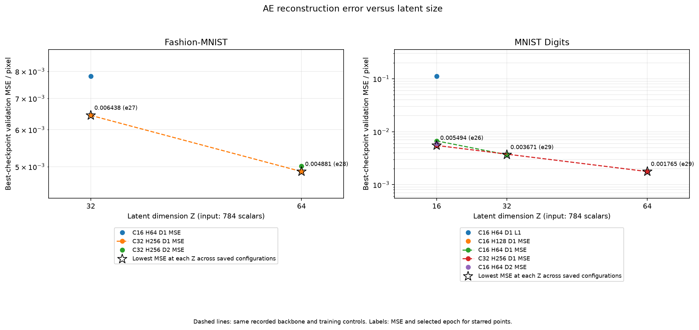

Each point is a measured best-checkpoint result; dashed lines join matching
backbones and training controls. Stars mark the lowest MSE at each Z across the
available configurations. Some starred points use different backbones, so they
cannot isolate the effect of Z. The y-axis is logarithmic. The
[compression analysis](artifacts/ae_compression_01/compression.md) includes the
best-result-only view and eight individual configuration plots. Three groups have
multiple latent sizes; five have only one point. Missing sizes were not estimated
and no additional latent sweep was trained for these plots.

Z=16, 32 and 64 correspond to scalar ratios of 49:1, 24.5:1 and 12.25:1. Larger
latents improved reconstruction in all three matched comparisons. The lowest
saved AE MSE on both datasets used Z64/C32/H256/D1, with 1,708,801 parameters.

| Digits AE, selected epoch 29 | Fashion AE, selected epoch 28 |
| --- | --- |
| 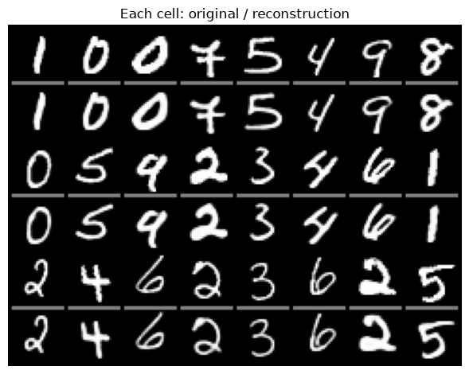 | 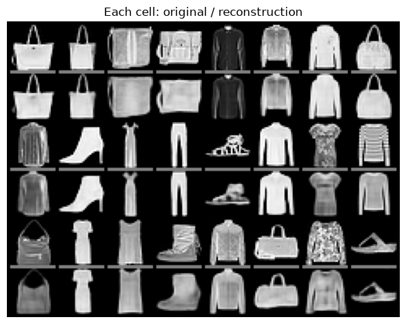 |

Digit strokes are closely reconstructed in these examples. Fashion silhouettes
are preserved, but stripes, lettering, knit patterns and footwear details are
smoothed. Increasing Fashion depth from D1 to D2 at Z64/C32/H256 did not improve
validation MSE: 0.004881 versus 0.005014. The L1 digit run failed, selecting epoch
1 with MSE 0.111860 and nearly black outputs; it remains included in the results.

### VAE: architecture size and dataset comparison

The Bernoulli experiments began at Z16/C16/H64/D1 and increased capacity when
needed. All entries below use beta=1 and 30 epochs.

| Dataset | Z/C/H/D | Selected epoch | Negative ELBO | KL | MSE |
| --- | --- | --- | --- | --- | --- |
| Digits | 16/16/64/1 | 30 | 94.1289 | 24.6770 | 0.012073 |
| Digits | 32/32/128/1 | 30 | 91.9754 | 26.0938 | 0.011151 |
| Digits | 32/64/256/1 | 30 | 91.2263 | 26.5931 | 0.010893 |
| Digits | 64/32/256/1 | 29 | 91.2631 | 25.5217 | 0.011003 |
| Digits | 64/64/256/1 | 29 | 91.6083 | 26.3996 | 0.010908 |
| Digits | 64/64/512/1 | 30 | 91.3139 | 26.8139 | 0.010799 |
| Fashion | 32/64/256/1 | 30 | 232.7867 | 18.2265 | 0.014198 |

Moving from the smallest digit network to Z32/C64/H256/D1 improved validation
negative ELBO from 94.1289 to 91.2263. Further size increases produced diminishing
returns. Z64/C64/H512/D1 had slightly lower MSE, but negative ELBO 91.3139 did not
beat the Z32/C64/H256/D1 reference. Z64/C32/H256/D1 used 1,725,249 parameters and
was close at 91.2631, compared with 3,507,137 parameters for Z32/C64/H256/D1.

For a common Z32/C64/H256/D1 backbone, Fashion had higher negative ELBO
(232.7867 versus 91.2263) and MSE (0.014198 versus 0.010893) than Digits under the
same Bernoulli protocol. Fashion also retained less fine detail visually.

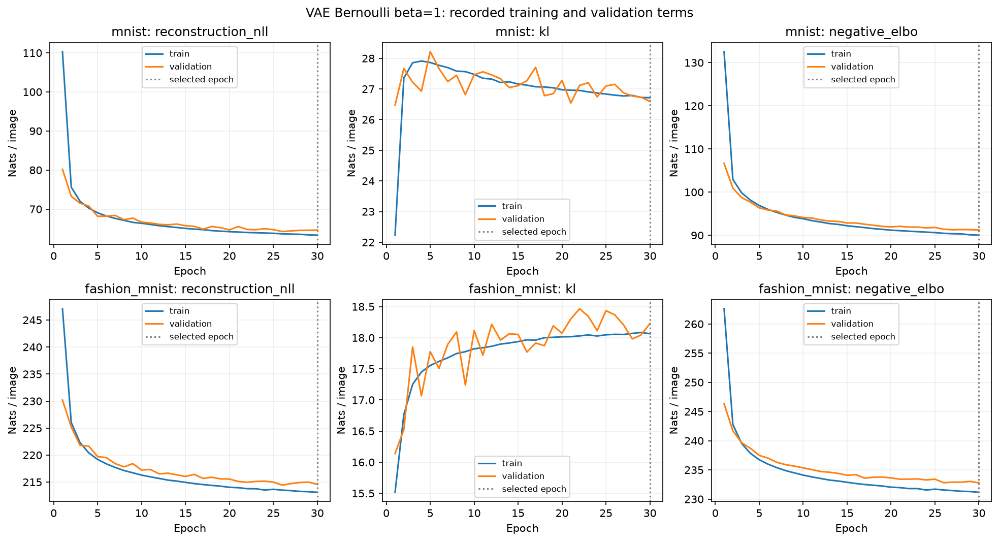

The plots show reconstruction NLL, KL and ordinary negative ELBO for that shared
backbone on each dataset. At beta=1, the ordinary negative ELBO is also the
training objective. The selected checkpoints are epoch 30 on both datasets.

| Digits VAE reconstructions | Fashion VAE reconstructions |
| --- | --- |
| 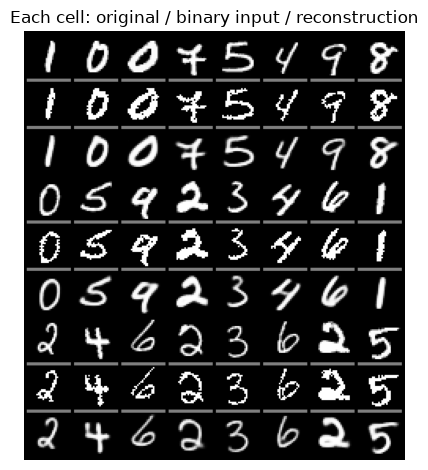 | 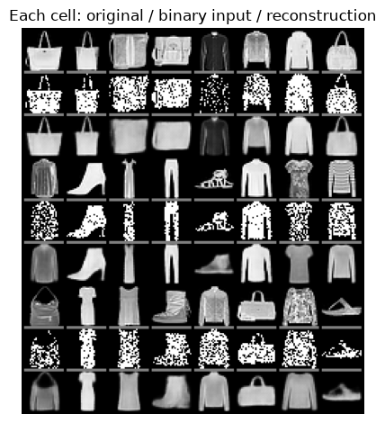 |

Each comparison cell stacks the grayscale original, binarized input and
reconstruction. The middle row illustrates information changes introduced by the
Bernoulli observation protocol.

| Digits: prior samples | Fashion: prior samples |
| --- | --- |
| 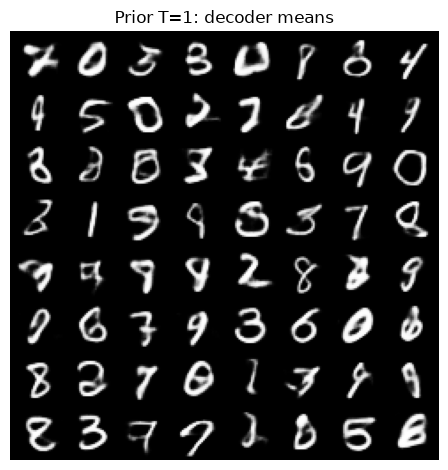 | 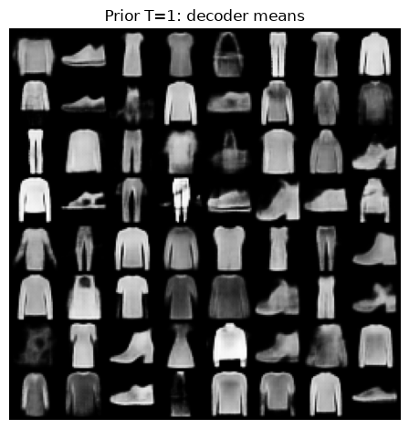 |

Both models produce varied recognizable shapes, with ambiguous samples remaining.
Digit loops and strokes are generally clearer than Fashion textures and garment
details. These are unconditional prior draws, rather than reconstructions of input
images. Strong reconstruction quality does not ensure equally good prior samples.

### Gaussian likelihood and beta experiments

The Gaussian observation model was explored to preserve grayscale detail. Every
entry below uses observation standard deviation 0.1. These continuous-density
scores form a separate comparison from the Bernoulli table.

| Dataset | Z/C/H/D | Beta | Epoch budget | Selected epoch | Negative ELBO | KL | MSE |
| --- | --- | --- | --- | --- | --- | --- | --- |
| Digits | 32/64/256/1 | 2 | 30 | 28 | -863.5150 | 61.2982 | 0.004081 |
| Digits | 32/64/256/1 | 4 | 30 | 26 | -831.4899 | 46.4523 | 0.005276 |
| Digits | 64/128/1024/1 | 4 | 30 | 26 | -830.1055 | 47.3404 | 0.005289 |
| Fashion | 32/64/256/1 | 1 | 30 | 26 | -742.6236 | 68.6089 | 0.006978 |
| Fashion | 32/64/256/1 | 2 | 30 | 21 | -737.2400 | 52.4875 | 0.007527 |
| Fashion | 32/64/256/1 | 4 | 30 | 29 | -710.7894 | 36.5546 | 0.008608 |
| Fashion | 32/64/256/1 | 4 | 60 | 40 | -710.7761 | 36.9773 | 0.008598 |
| Fashion | 64/64/512/1 | 1 | 30 | 23 | -761.1211 | 81.1716 | 0.006186 |

For the same Fashion Z32/C64/H256/D1 backbone at beta=1, grayscale MSE decreased
from 0.014198 with Bernoulli observations to 0.006978 with Gaussian observations.
This changes both the likelihood and whether the encoder receives grayscale or
binarized inputs, so the improvement cannot be attributed to the likelihood term
alone. The larger Z64/C64/H512/D1 Gaussian model reduced MSE further to 0.006186.

| Fashion Gaussian VAE reconstructions, beta1 | Fashion Gaussian VAE prior samples, beta1 |
| --- | --- |
|  | 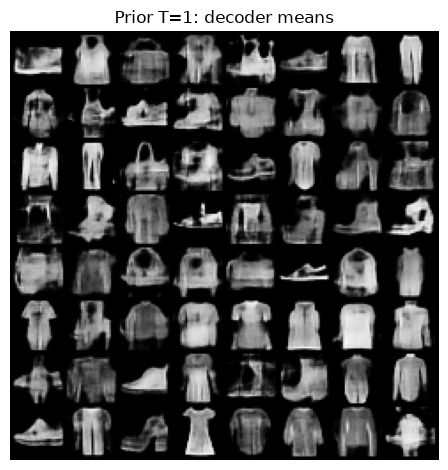 |

Reconstructions preserve more grayscale information, but many prior samples have
patchy textures or malformed silhouettes. Increasing beta reduced KL and generally
sacrificed reconstruction fidelity. On Fashion, beta1 -> beta4 reduced KL from
68.6089 to 36.5546 while MSE increased from 0.006978 to 0.008608. The beta2 run was
not a visually preferred generation improvement in the earlier experiment review.

Extending Fashion beta4 to 60 epochs selected epoch 40 at negative ELBO -710.7761,
very close to the separate 30-epoch run's -710.7894. By epoch 60, training negative
ELBO had improved to -786.2172 while validation worsened to -705.4172, supporting
overfitting late in that run. Its
[recorded negative-ELBO curve](artifacts/report_runs/vae_fashion_mnist_z32_c64_h256_d1_gaussian_std01_beta4_e60/negative_elbo.png)
shows that divergence.

The very large Digits Z64/C128/H1024/D1 Gaussian beta4 model contained 26,954,625
parameters, compared with 3,507,137 for Z32/C64/H256/D1. Its negative ELBO
(-830.1055) and MSE (0.005289) did not improve on the smaller beta4 run
(-831.4899 and 0.005276). More capacity alone was insufficient in this comparison.

### f-VAE: posterior flows and controlled comparisons

The first full-data f-VAE used Z16/C16/H64/D1 with F4/FH64. It reached negative
ELBO 93.0124 at epoch 26, compared with 94.1289 for the plain VAE with the same
image backbone, beta and recorded training controls. This is a modest observed
improvement from the flow posterior in one training run per setting.

The larger controlled experiments fixed Z32/C32/H256/D1, Bernoulli observations,
30 epochs, batch 64 and learning rate 0.001, varying beta, F and FH. FH32, FH64 and
FH128 denote conditioner width, not the image encoder's H=256.

| Dataset | F/FH | Beta | Selected epoch | Negative ELBO | Recon NLL | KL | MSE |
| --- | --- | --- | --- | --- | --- | --- | --- |
| Digits | 4/32 | 1 | 28 | 90.7509 | 65.2560 | 25.4949 | 0.010860 |
| Digits | 4/64 | 1 | 30 | 90.5943 | 64.9363 | 25.6580 | 0.010810 |
| Digits | 2/64 | 1 | 27 | 90.8676 | 64.9533 | 25.9143 | 0.010847 |
| Digits | 4/32 | 4 | 30 | 106.6972 | 96.1238 | 10.5735 | 0.021322 |
| Digits | 4/64 | 4 | 30 | 107.2591 | 96.8269 | 10.4322 | 0.021602 |
| Digits | 2/64 | 4 | 30 | 106.8673 | 96.2949 | 10.5724 | 0.021401 |
| Fashion | 4/32 | 1 | 30 | 232.8148 | 215.9051 | 16.9097 | 0.014474 |
| Fashion | 4/64 | 1 | 30 | 232.7821 | 215.9783 | 16.8038 | 0.014498 |
| Fashion | 2/64 | 1 | 30 | 232.9599 | 216.1504 | 16.8095 | 0.014550 |
| Fashion | 4/32 | 4 | 28 | 243.8420 | 236.6915 | 7.1505 | 0.021474 |
| Fashion | 4/64 | 4 | 29 | 244.0994 | 237.0055 | 7.0939 | 0.021687 |
| Fashion | 2/64 | 4 | 28 | 243.8159 | 236.6826 | 7.1333 | 0.021476 |

For beta1, F4/FH64 had the lowest recorded negative ELBO among these three layouts
on both datasets, although the differences are small. F2/FH64 and F4/FH32 were
close and showed broadly similar generation quality. In the additional Digits
beta4 experiments, F4/FH128 reached 107.3028 and F8/FH64 reached 107.1133, compared
with 107.2591 for F4/FH64 and 106.6972 for F4/FH32. Wider conditioners or additional
couplings did not establish a consistent improvement.

The Z32/C32/H256/D1 F4/FH64 models have 1,742,337 parameters. Their beta1 negative
ELBOs are 90.5943 on Digits and 232.7821 on Fashion. The larger plain VAE references
use a different C64 backbone, so comparing their scores does not isolate the
benefit of the posterior flow. The small matched-backbone comparison above is the
cleaner flow ablation. Single training seeds do not establish statistical rankings.

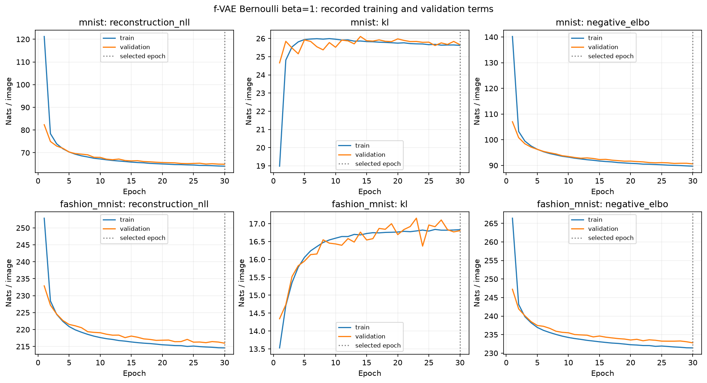

| Digits f-VAE reconstructions, F4/FH64 beta1 | Fashion f-VAE reconstructions, F4/FH64 beta1 |
| --- | --- |
| 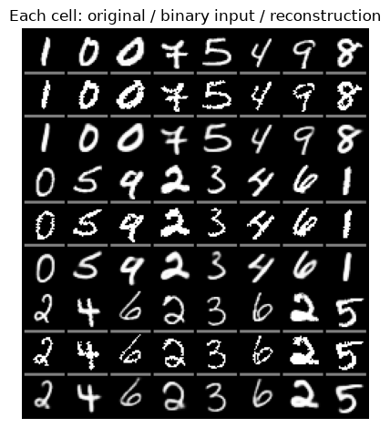 | 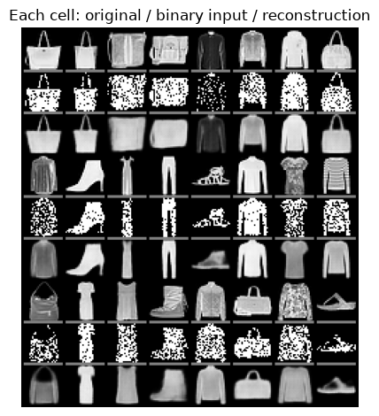 |

In the generation figures below, the upper row is beta1 and the lower row beta4;
columns are F4/FH32, F4/FH64 and F2/FH64. Each panel contains 64 prior decoder means
at temperature 1. Corresponding cells across models need not represent the same
class because their latent coordinate meanings can differ.

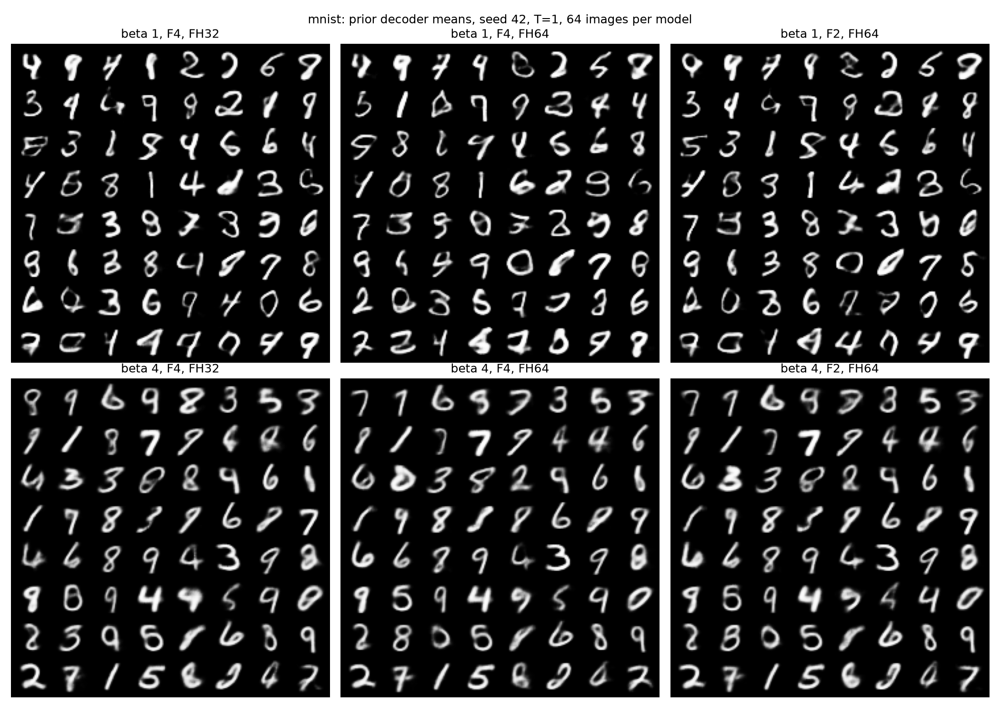

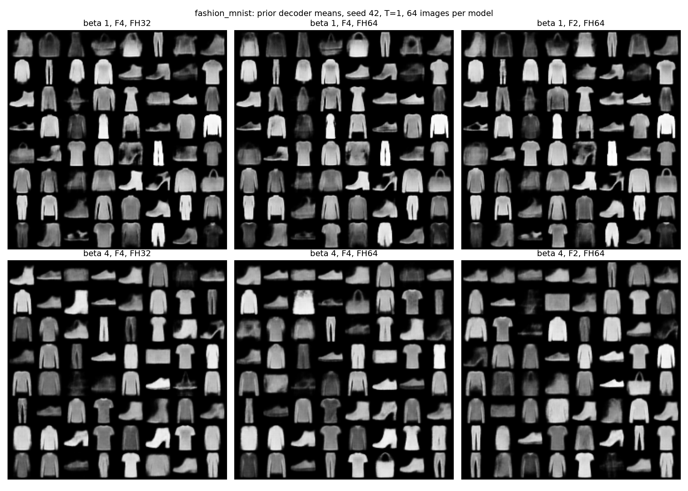

The [full dataset/beta comparison](artifacts/fvae_dataset_beta_comparison_01/results.md)
includes seeds 42, 123 and 2026, exact commands and logs. The
[initial flow-layout experiment](artifacts/fvae_mnist_controlled_01/results.md)
also documents FH128 and F8. Sampling seeds are inference repeats, not independent
training repeats.

### Optional beta exploration: diversity and latent factors

Increasing beta in the matched F4/FH64 models reduced KL from 25.6580 to 10.4322
on Digits and from 16.8038 to 7.0939 on Fashion. MSE increased from 0.010810 to
0.021602 and from 0.014498 to 0.021687, respectively. Thus stronger regularization
had a substantial reconstruction cost in these settings.

The three-seed generation review found multiple recognizable categories at both
weights. beta1 generally retained more stroke/style variation on Digits and more
appearance detail on Fashion. beta4 generated softer, simpler forms; the earlier
preference for its digit coherence was a visual preference, rather than a
universal improvement in diversity or validation likelihood. No classifier-based
class coverage, diversity score or memorization check was computed.

Each traversal below varies one of the first eight prior coordinates across nine
values from -3 to +3, keeping all other coordinates at zero. Every row therefore
shares the same central image. The posterior flow is bypassed for these prior-space
traversals, as it is for unconditional generation.

| Digits, F4/FH64 beta1 | Digits, F4/FH64 beta4 |
| --- | --- |
| 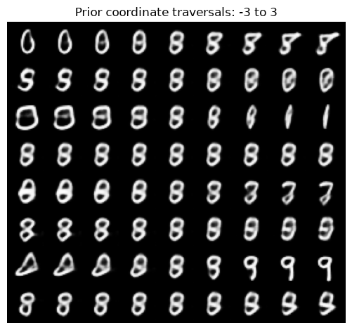 | 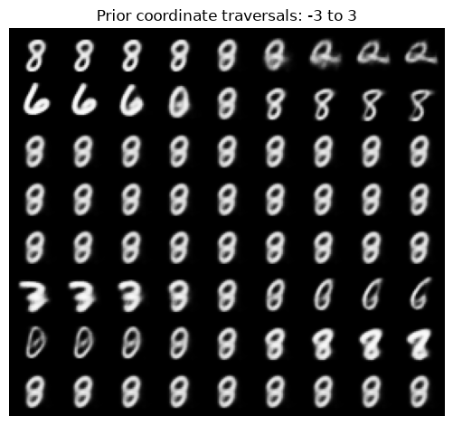 |

| Fashion, F4/FH64 beta1 | Fashion, F4/FH64 beta4 |
| --- | --- |
| 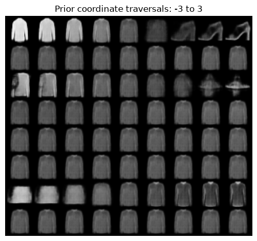 | 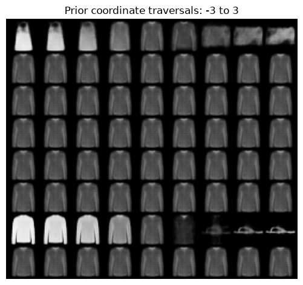 |

On Digits, individual coordinates can change identity, width and loop structure
together. On Fashion, active coordinates change brightness, silhouette and
apparent category together. beta4 has more nearly unchanged rows in these
particular views, but this does not prove unused coordinates or better semantic
separation. **Meaningful visual factors are represented, but remain mixed in the
inspected directions; improved disentanglement at beta4 is not established.**
Only eight of 32 coordinates at one zero anchor were inspected. The
[detailed traversal review](artifacts/fvae_dataset_beta_comparison_01/diversity_and_traversals.md)
records row-specific observations and these limits. The optional exploration
therefore provides qualitative evidence, rather than a quantitative
disentanglement claim.

### Artifact reproduction

Configurations, histories and summaries for all 42 runs, selected figure copies
for ten reference runs, and the VAE/f-VAE training-term plots can be regenerated
from existing files without training, model inference or dataset downloads:

```powershell
uv run --locked python homeworks/02_vae/build_report_artifacts.py
```

The [AE compression instructions](experiments.md#saved-ae-compression-analysis)
provide the separate analysis command for refreshing latent-size plots into a
fresh directory. Original checkpoints and their experiment directories are
preserved; the report exporter copies records and figures, not weights or data.

## What worked well

- Small networks were useful baselines. The Z16/C16/H64/D1 AE already reconstructed
  digits well enough to identify bottleneck limitations before scaling the model.
  The plain VAE with that backbone also trained successfully and generated samples.
- Increasing latent size improved AE reconstruction in each matched comparison,
  especially on Digits. The Z64/C32/H256/D1 AE gave the lowest saved MSE on both
  datasets, while still compressing 784 input scalars to 64 latent scalars.
- The VAE learned both datasets and supported unconditional generation. Increasing
  capacity improved the small digit baseline, with diminishing returns beyond the
  intermediate architectures.
- Gaussian observations substantially improved grayscale reconstruction, especially
  on Fashion. This was useful for studying the difference between reconstruction
  fidelity and prior-generation quality.
- The RealNVP posterior integrated successfully with the VAE and produced finite
  objectives and usable generations. The small matched-backbone experiment showed
  a modest validation improvement; the controlled larger runs made the beta trade-off
  much clearer than the small F/FH changes.
- Fixed-seed generation grids, 24-example reconstructions and latent traversals made
  visual limitations easier to identify than loss curves alone.

## What did not work as expected

- Good early AE reconstructions initially suggested an oversized model, but visual
  reconstruction quality alone was insufficient to diagnose overfitting. Smaller
  bottlenecks exposed smoothing and missing details even when digits were recognizable.
- The L1 digit AE collapsed toward black outputs rather than improving sharpness.
  Its poor result was retained rather than omitted from the comparison.
- Adding Fashion AE depth at Z64/C32/H256 did not recover texture or improve MSE.
  Increasing VAE size also did not reliably improve likelihood or generations.
- Improved Gaussian reconstructions did not translate into equally convincing
  random prior samples. Clothing samples could retain texture-like patches while
  losing coherent garment structure.
- Increasing beta reduced KL but worsened reconstruction and ordinary negative
  ELBO. beta2 was not a consistent visual generation improvement, and beta4 did
  not establish cleaner semantic factor separation in the inspected traversals.
- Longer training did not solve the Fashion Gaussian model's limitations; the
  60-epoch run showed a worsening validation score late in training.
- Wider or deeper posterior flows did not provide a clear general improvement
  within the tested epoch budget. Ambiguous digits and malformed or overly smooth
  Fashion items remain in otherwise varied generation grids.

## Possible explanations for limitations

- A finite bottleneck and pixelwise reconstruction objective can preserve broad
  silhouettes while averaging over hard-to-predict fine details. Fashion contains
  substantially more texture and shape complexity than Digits. This is consistent
  with the observed reconstructions, but the contributions of bottleneck capacity,
  decoder architecture and loss were not fully separated.
- Gaussian standard deviation 0.1 weights squared reconstruction error by 50 before
  adding the KL term. This changes the reconstruction/regularization balance. Good
  reconstructions alongside malformed prior samples are consistent with a mismatch
  between the aggregate posterior and the sampling prior, but that mismatch was
  not measured directly.
- Stronger beta penalizes latent information more heavily. Lower KL and worse MSE
  support that trade-off here; lower KL alone is not evidence of disentanglement.
- The flow increases posterior flexibility without adding image-space decoder
  capacity. If decoder expressiveness or the observation model limits detail,
  more latent couplings may have little visible benefit.
- For the failed L1 run, background-dominated images and a saturated sigmoid are
  plausible optimization contributors to nearly black outputs. This is an
  explanation for that run, rather than a general claim that L1 cannot work.
- Single training seeds, stochastic ELBO estimates and a fixed 30-epoch budget
  limit interpretation of small metric gaps. The zero-anchor traversal probes
  local directional sensitivity, not globally consistent semantic controls.

## Potential improvements

1. Make a more controlled reconstruction comparison using matching latent sizes
   and grayscale input protocols for AE and the variational models. Select any
   future configurations using validation results; keep the completed final test
   results separate from further model selection.
2. Extend the controlled AE latent sweep while keeping the backbone fixed, adding
   smaller and intermediate Z values. The existing plots can be expanded from
   newly measured points without changing their interpretation.
3. Repeat selected configurations with independent training seeds. Compare larger
   VAE and f-VAE models using identical image backbones to isolate posterior-flow
   effects beyond the existing small-backbone comparison.
4. Examine all latent coordinates around several prior and encoded-image anchors.
   Check whether the same property changes consistently, and distinguish locally
   insensitive directions from globally unused coordinates.
5. Add class coverage and within-class variation measurements, and nearest-neighbor
   comparisons against training images, before making stronger diversity or
   memorization claims.
6. Test one optimization or reconstruction change at a time, such as a learning-rate
   schedule, KL warm-up, observation standard deviation, or a decoder modification.
   State how each changes the experiment instead of assuming larger models or
   stronger regularization will improve generation.
