# Generative Adversarial Networks report

> **GAN - 10pt. (+2pt.)**
>
> Vanilla GAN
> - Implement a basic GAN pipeline consisting of a generator and discriminator.
> - Train the GAN on MNIST and Fashion-MNIST datasets.
> - Monitor training stability by plotting generator and discriminator losses over time.
> - Evaluate the quality of generated samples and check for mode collapse by visualizing generated batches during training.
>
> Conditional and Advanced GAN Variants
> - Implement a Class-Conditional GAN (cGAN) where the generator is conditioned on class labels.
> - Extend the discriminator by experimenting with: PatchGAN architecture, Feature Matching Loss
> - Compare the visual quality and diversity of generated samples before and after these modifications.
>
> Bonus (optional): Progressive Growing GAN - 2pt.
> - Implement a Progressive GAN and train it on the CIFAR-10 dataset.
> - Gradually increase image resolution during training to improve stability and generation quality.
> - Visualize the evolution of generated images as the model grows.

## Implementation and experimental setup

### Models and architecture

GC/DC denotes the base generator/discriminator channel widths. The original baseline used GC64/DC64. Later experiments favored a larger generator with a smaller discriminator, and GC256/DC64 became the common cGAN configuration.

### Evaluation and checkpoint selection

Generator/discriminator losses describe the current adversarial game. Their minimum is not a reliable image-quality criterion. The final pipeline therefore selects **one paired G/D checkpoint by minimum validation KID-style MMD**, saving both optimizer states and the corresponding fixed-noise grid.

For each dataset, a separate classifier is fitted on 48,600 images from the GAN training split, with an internal 5,400-image classifier-selection split. Neither part includes the GAN validation reference. A fixed subset of **5,000 held-out validation images** is selected using reference seed 2026. Each GAN checkpoint is compared with **5,000 generated images from the same fixed noise bank**. Conditional evaluation uses fixed labels from the real reference, preserving its class proportions; the separate 10x10 preview grids are exactly class-balanced.

The frozen classifier extracts features from both real and generated images. The metric is the full-sample unbiased MMD-squared estimator with polynomial kernel `k(u,v) = (u.T @ v / feature_dim + 1)^3`, excluding within-set diagonals. Raw features are not normalized; kernel sums use float64 CPU blocks. Negative unbiased estimates would be valid and are not clipped. This is **dataset-classifier KID-style MMD, not standard Inception KID or a likelihood**. Lower is better only within the same feature space and protocol.

| Evaluation classifier | Feature dimension | Accuracy on the fixed real reference |
| --- | ---: | ---: |
| Digits | 128 | 98.70% |
| Fashion v1 | 128 | 90.78% |
| Fashion v2 | 256 | 94.88% |

Fashion v2 uses six convolutions with base width 64, batch normalization and dropout. It was trained separately for 30 epochs using AdamW, cosine scheduling and crop/flip augmentation; internal selection retained epoch 21. These classifier settings do not change the GAN training objective. The [classifier comparison](artifacts/fashion_classifier_upgrade_01/classifier_comparison.json) records accuracy, confidence, calibration diagnostics and confusion matrices.

Each evaluation also records predicted-class counts, coverage, entropy, mean classifier confidence and the fraction with maximum probability at least 0.8. Confident coverage requires at least five confident predictions per counted class. Entropy is reported in nats and normalized by `log(10)`. cGAN additionally records agreement between the classifier prediction and the requested label. Confidence and label agreement are diagnostics, not ground-truth human judgments; multiplying classifier accuracy by generated confidence does not estimate a percentage of correct generations.

Fashion v1/v2 scores, and Digits/Fashion scores, are **different scales**. The Fashion upgrade rescored the existing saved checkpoints. It did not recover discarded epoch weights, so it could not reselect every historical epoch under v2. New Fashion runs were selected directly using v2.

## Results and required artifacts

### Representative selected models

All scores below are validation-reference measurements. Epoch budgets and learning rates differ between these experiment endpoints; the matched comparisons appear later.

| Dataset | Family | GC/DC | G/D learning rates | Budget | Selected epoch | KID | Confident fraction |
| --- | --- | --- | --- | ---: | ---: | ---: | ---: |
| Digits | Best recorded vanilla GAN | 256/64 | 0.0002/0.0001 | 100 | 97 | 3.6166 | 85.40% |
| Fashion, v2 | Vanilla GAN, continued | 256/64 | 0.0001/0.0002 | 60 total | 58 | 8.3322 | 70.02% |
| Digits | Global cGAN reference | 256/64 | 0.0001/0.0002 | 60 | 60 | 0.2803 | 98.38% |
| Fashion, v2 | Global cGAN reference | 256/64 | 0.0001/0.0002 | 60 | 56 | 1.3987 | 86.56% |

The global cGAN remains the reference for both datasets. Feature matching was a successful alternative at the matched 30-epoch budget, with small KID gains, but was not trained to 60 epochs in this ablation batch. Its 30-epoch scores should not be ranked as if they had received the same budget as the 60-epoch references

| Selected vanilla Digits, epoch 97 | Selected vanilla Fashion, epoch 58 |
| --- | --- |
| 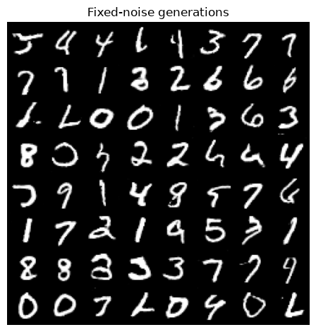 | 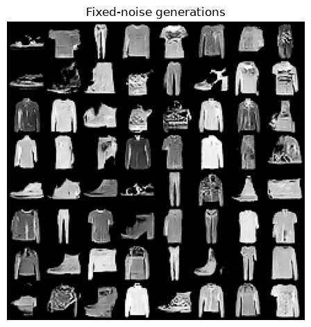 

### Vanilla GAN: Digits architecture and optimization

The initial experiments varied the relative generator/discriminator widths at batch 64, learning rates 0.0002/0.0002 and 30 epochs.

| GC/DC | Selected epoch | KID |
| --- | ---: | ---: |
| 64/64 | 26 | 37.6937 |
| 128/128 | 15 | 41.1339 |
| 64/128 | 11 | 48.7618 |
| 128/64 | 29 | 33.4457 |
| 256/256 | 10 | 39.5882 |

Increasing both networks did not reliably improve the result. A larger generator with DC64 was the most promising direction in this initial group. A fresh 60-epoch GC128/DC64 run reached KID 22.1967; its 100-epoch counterpart reached 18.3816. The recorded [width comparison](artifacts/mnist_width_comparison_01.csv) and [longer-run comparison](artifacts/mnist_gc128_dc64_e60_comparison_01.csv) retain the original measurements.

The next controlled group used 60 epochs and learning rates 0.0002/0.0002:

| GC/DC | Batch | Paired updates | Selected epoch | KID |
| --- | ---: | ---: | ---: | ---: |
| 128/64 | 64 | 50,640 | 60 | 22.1967 |
| 128/64 | 128 | 25,320 | 60 | 21.5107 |
| 128/64 | 256 | 12,660 | 58 | 24.3525 |
| 256/64 | 64 | 50,640 | 59 | 11.6217 |
| 256/128 | 64 | 50,640 | 59 | 21.1811 |

Doubling GC to 256 with DC64 produced a much larger gain than the batch changes. Batch 128 slightly improved the GC128/DC64 KID, while batch 256 was worse. These results do not establish that smaller batches are always better: batch size, update count and architecture were not independently matched in every run.

The GC256/DC64 learning-rate grid then kept batch 64 and a 60-epoch budget.

| G learning rate | D learning rate | Selected epoch | KID |
| --- | --- | ---: | ---: |
| 0.0001 | 0.0001 | 60 | 16.1344 |
| 0.0001 | 0.0002 | 59 | 27.4054 |
| 0.0001 | 0.0004 | 58 | 53.6779 |
| 0.0002 | 0.0001 | 56 | 6.8700 |
| 0.0002 | 0.0002 | 59 | 11.6217 |
| 0.0002 | 0.0004 | 59 | 20.5772 |
| 0.0004 | 0.0001 | 58 | **4.9925** |
| 0.0004 | 0.0002 | 58 | 8.2192 |
| 0.0004 | 0.0004 | 54 | 12.2802 |

Within this grid, a slower D and faster G were useful. The extreme opposit balance, G=0.0001/D=0.0004, was the worst tested combination. 

The three leading learning-rate configurations were also trained in fresh 100-epoch runs:

| G/D learning rates | Selected epoch | KID |
| --- | ---: | ---: |
| 0.0004/0.0001 | 100 | 3.8708 |
| 0.0002/0.0001 | 97 | **3.6166** |
| 0.0004/0.0002 | 97 | 4.1481 |

The best observed learning-rate setting changed with the longer budget. These fresh runs did not exactly repeat the first 60 epochs of earlier runs, so the comparison is not an exact continuation experiment. Full settings, scores and timings are in the [Digits sweep CSV](artifacts/gan_mnist_sweep_01/metrics.csv).

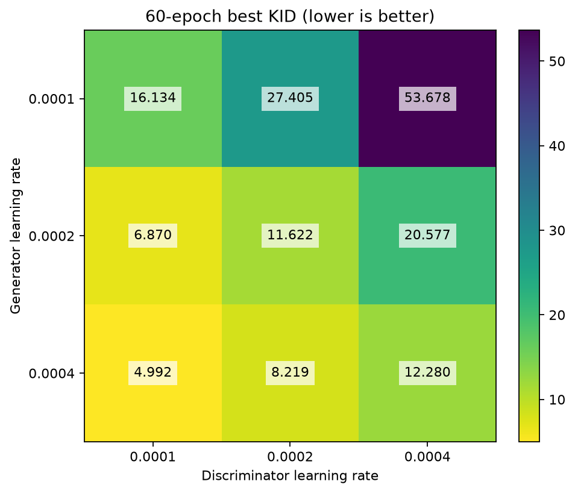

### Vanilla GAN: Fashion width sweep and evaluation upgrade

Fashion initially used 30 epochs, batch 64 and learning rates 0.0002/0.0002. The table explicitly separates the old v1 scores from v2 rescoring of the same saved checkpoints.

| GC/DC | Saved epoch, selected by v1 | Original v1 KID | Same checkpoint: v2 KID | v2 confident fraction |
| --- | ---: | ---: | ---: | ---: |
| 256/64 | 17 | 0.9281 | 10.8682 | 68.12% |
| 256/128 | 17 | 2.9119 | 12.1812 | 65.78% |
| 256/256 | 20 | 5.8067 | 14.6883 | 64.14% |
| 512/256 | 16 | 4.5258 | 15.5675 | 63.68% |
| 512/128 | 14 | 2.1096 | 14.2745 | 63.10% |
| 512/64 | 25 | 0.8764 | 10.7103 | 67.22% |

The original low Fashion KID values and generated confidence near 60% motivated checking the evaluator. Upgrading reference classification accuracy from 90.78% to 94.88% changed both features and confidence estimates. The jump in KID scale does not indicate deterioration of those unchanged generator weights. The v2 rescores still favored DC64, with GC256 and GC512 close enough that neither was a clear practical winner. See the [rescoring data](artifacts/fashion_classifier_upgrade_01/metrics.csv).

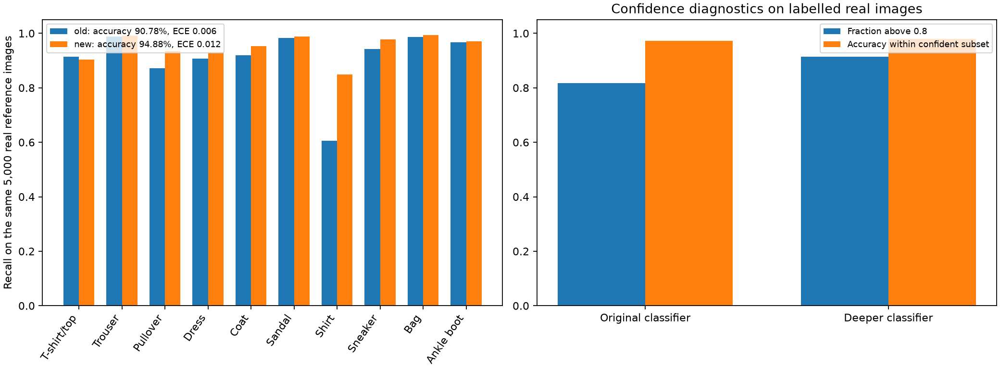

Fresh v2-selected runs then reduced the generator learning rate to 0.0001, keeping D at 0.0002. Both were continued from their saved best checkpoints to total epoch 60:

| GC/DC | Best within original 30 epochs: epoch / KID | Resume epoch | New epochs | Best through total 60: epoch / KID | Confident fraction, before -> after |
| --- | --- | ---: | ---: | --- | --- |
| 256/64 | 27 / 11.8304 | 27 | 33 | 58 / **8.3322** | 66.44% -> 70.02% |
| 512/64 | 30 / 11.8775 | 30 | 30 | 60 / **8.4516** | 67.28% -> 70.58% |

The continuations restored paired G/D weights and both Adam states. Legacy checkpoints lacked complete RNG snapshots, so these are valid training branches, not exact replays of the abandoned parent trajectories. The GC256 branch uses parent epochs 1-27 followed by new epochs 28-60; the original parent epochs 28-30 are excluded from its effective history.

Additional training reduced KID by about 30% and 29%. GC256 was slightly lower and cheaper than GC512, supporting GC256/DC64 as the shared next reference. The lower G learning rate did not immediately beat the old rescored checkpoints at 30 epochs. There was no matched 60-epoch Fashion control at the old G rate, so these results do not isolate a benefit from lowering the rate.

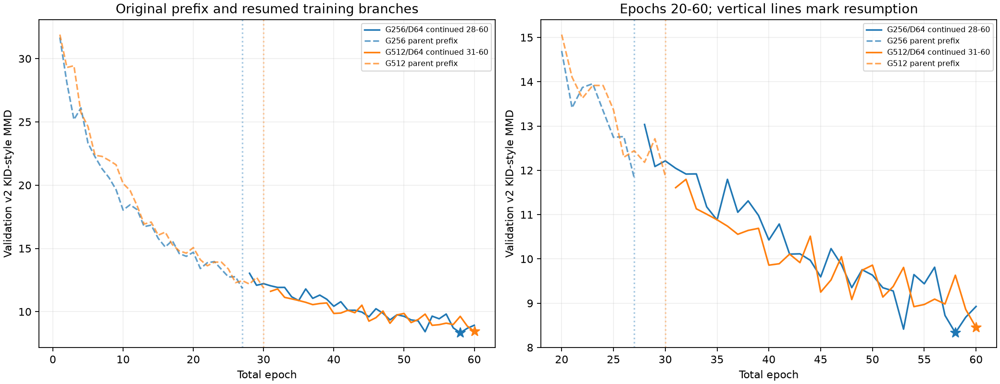

### Class-conditional generation

Fresh cGANs used the same GC256/DC64, batch 64, latent 100, G/D rates 0.0001/0.0002 and 60-epoch budget on both datasets. Class labels supplied direct control over the category; noise continued to provide variation within a class.

The following comparisons use the same channel widths, learning rates, dataset-specific evaluation bundles and 60-epoch budget. The Fashion vanilla run includes the resume branch described above; conditioning also adds embedding parameters, so this is not a parameter-count-matched experiment.

| Dataset | Vanilla KID / selected epoch | cGAN KID / selected epoch | Confident fraction, vanilla -> cGAN | cGAN label agreement |
| --- | --- | --- | --- | ---: |
| Digits | 27.4054 / 59 | **0.2803 / 60** | 80.70% -> 98.38% | 99.20% |
| Fashion, v2 | 8.3322 / 58 | **1.3987 / 56** | 70.02% -> 86.56% | 91.86% |

The matched Digits vanilla comparator is the low-G-rate 60-epoch run, not the separately optimized 100-epoch vanilla endpoint. Both comparisons show a large measured benefit from the conditional setup in these runs, without establishing the same advantage for every learning-rate configuration or seed.

| Digits cGAN: selected epoch 60 | Fashion cGAN: selected epoch 56 |
| --- | --- |
| 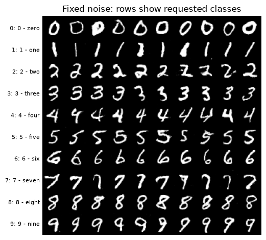 | 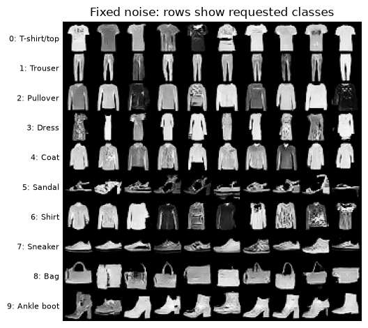 |

Digits generally have coherent loops and strokes, with visible changes in thickness and shape within rows. Fashion contains recognizable garment and shoe categories, but ambiguous shirts/coats, patchy textures and malformed details remain. The different classifier spaces prevent using the two KID magnitudes as a direct measure of relative dataset difficulty.

The fixed-input progression shows why an early preview alone was insufficient to choose an endpoint. At 30 epochs the best cGAN KIDs were 3.2831 on Digits and 2.6111 on Fashion; by 60 they reached 0.2803 and 1.3987.

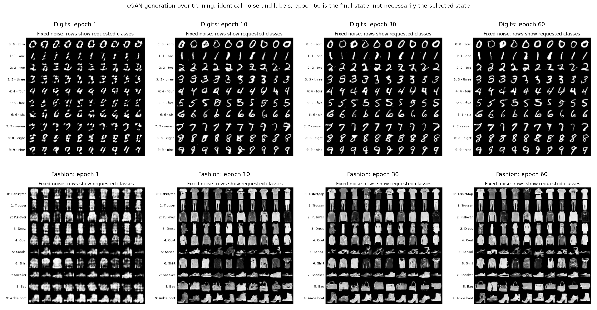

The last column shows actual epoch 60 outputs. On Fashion, that is distinct from the selected epoch-56 grid above. Generated samples over time are recorded independently of checkpoint improvements.

### Training stability and loss tracking

The following curves show train/validation G and D losses for the representative vanilla and conditional configurations. Dotted lines identify the checkpoint selected by KID, not a loss minimum. The Fashion vanilla panel marks the resume branch at epoch 27 and uses actual epoch labels.

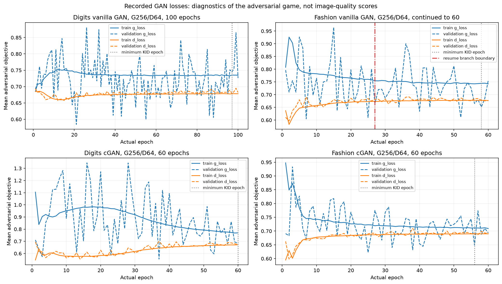

The adversarial losses fluctuate as the two networks adapt. Finite losses and successful optimization did not imply good generation: the PatchGAN Digits runs below completed normally while producing repeated templates. Likewise, a lower G or D loss by itself was not treated as evidence of better samples.

### Matched 30-epoch PatchGAN and feature-matching experiments

Six fresh runs tested PatchGAN, feature matching, and their combination on both datasets. Every run retained the cGAN reference settings, changing only the discriminator head and/or feature-matching weight. Feature matching used **lambda=10**; no weight sweep was performed.

For fairness, the baseline uses its best score **within the first 30 epochs**, not its best-60 result. The historical baseline grids were saved at epoch 20 for Digits and epoch 30 for Fashion. Their historical weights were not retained; the original baseline weight files now contain the best-60 checkpoints.

| Variant | Digits selected epoch | Digits KID | Fashion selected epoch | Fashion v2 KID |
| --- | ---: | ---: | ---: | ---: |
| Global cGAN baseline, first 30 epochs | 20 | 3.2831 | 30 | 2.6111 |
| PatchGAN | 22 | 236.5422 | 30 | 4.8110 |
| Global cGAN + feature matching | 29 | **3.2687** | 30 | **2.4908** |
| PatchGAN + feature matching | 3 | 188.0273 | 30 | 4.1084 |

On Digits, feature matching lowered best KID by only **0.44%**, with the same 99.24% label agreement. The last-ten-epoch average KID was also almost unchanged: 5.1061 versus 5.0849. It preserved good generation, but did not establish a meaningful improvement over the baseline.

On Fashion, feature matching lowered best KID by **4.61%**, while label agreement decreased from **91.66% to 90.54%** and confident fraction from **85.80% to 84.94%**. Its last-ten average KID was 3.5347 versus baseline 3.4324. It is a reasonable alternative, with a small endpoint improvement rather than a consistent win on all diagnostics.

The PatchGAN Digits grids show severe **within-class mode collapse**: different noise vectors produce nearly identical examples for a requested class. PatchGAN alone covered nine confidently predicted classes at its selected checkpoint; the combined variant covered all ten and had normalized predicted-class entropy 0.9972, yet still visibly repeated samples within each row. Class coverage and entropy therefore did not establish within-class diversity. Label agreement also remained misleadingly high: 90.46% for PatchGAN and 94.20% for the combined model, despite poor distribution scores and malformed/repeated glyphs.

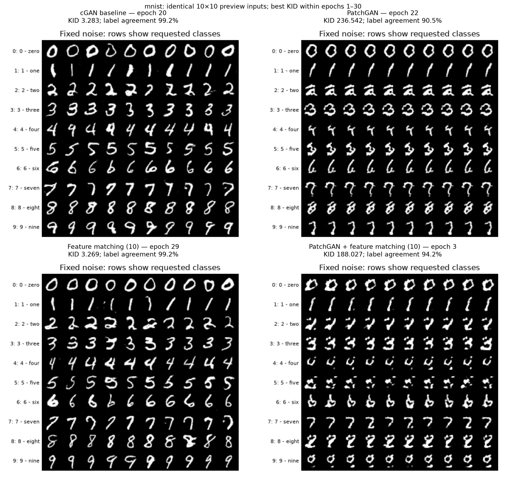

Fashion PatchGAN variants produced recognizable, varied clothing rather than the same severe collapse. However, their KID and label agreement remained worse than the global models. Feature matching improved PatchGAN KID from 4.8110 to 4.1084, but label agreement changed from 86.70% to 86.16%. Both Fashion patch variants selected their final epoch and improved sharply near the end; their eventual performance at 60 epochs remains unmeasured.

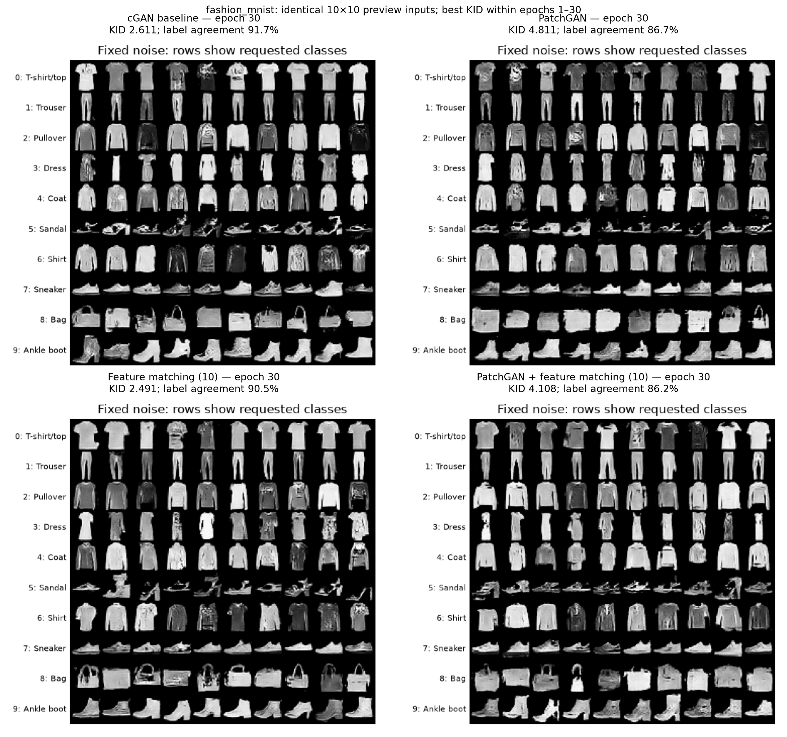

The comparison curves retain all 30 epochs, not just each selected minimum. The KID axes use a symmetric logarithmic scale, linear within +/-1, to keep both good runs and failed runs readable without clipping any unbiased estimates.

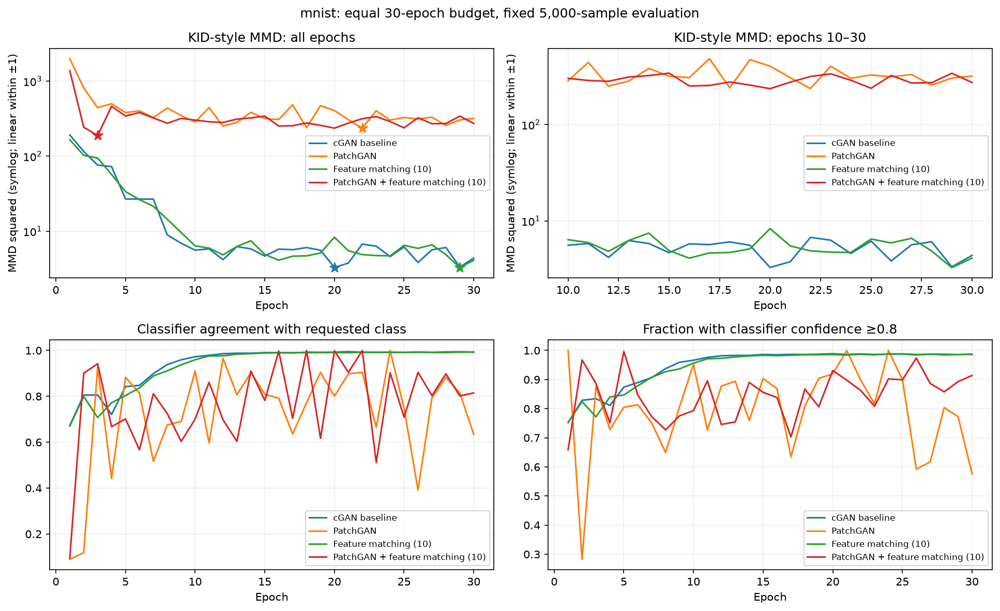

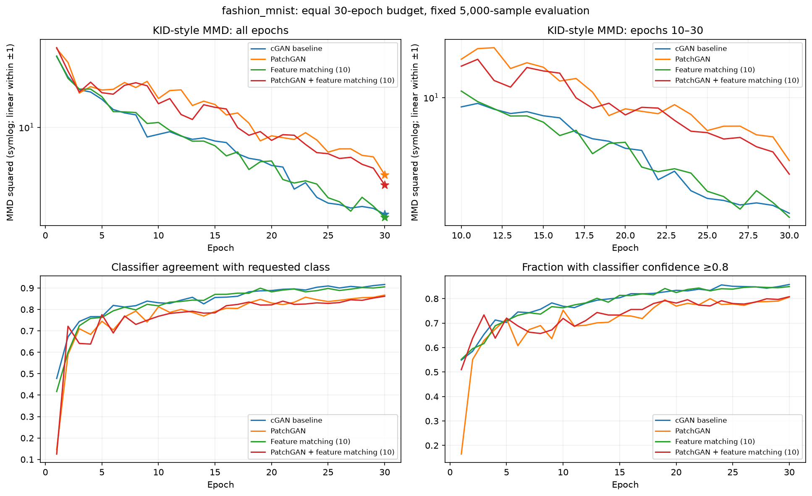

The global discriminator remains the practical reference. Feature matching worked well as a mild modification, but these single-seed results do not prove statistical superiority from its small gains. PatchGAN was not an improvement under the tested settings, especially on Digits.

### Deliverables, provenance and verification

The [artifact index](artifacts/index.md) links all experiment-group CSVs, manifests and comparison figures, plus copied configurations, histories, summaries, evaluation protocols and figures for **13 representative runs**.
The [representative CSV](artifacts/report_metrics.csv), [JSON](artifacts/report_metrics.json) and [source hashes](artifacts/report_provenance.json) retain full precision and checkpoint provenance. Weights remain in their original checkpoint directories and are linked from the index; they are not duplicated into report assets.

Report snapshots and the loss/progression figures can be rebuilt from existing records without training, model inference, dataset downloads or test evaluation:

```powershell
uv run --locked python homeworks/03_gan/build_report_artifacts.py
```

The [cGAN commands](artifacts/cgan_baseline_01/commands.txt) and [variant commands](artifacts/cgan_variants_01/commands.txt) record the actual training configurations. Repeating training requires fresh output directories. All results in this report are validation-based;

Recorded verification includes 54 passing GAN/model/training/evaluation tests before the variant batch and six successful CUDA smoke checks, followed by all six complete runs. Checks verified finite losses, 5,000 real/fake evaluation counts, identical noise and label banks, minimum-KID selection, optimizer step counts, saved grids and unchanged source/reference hashes. The [variant manifest](artifacts/cgan_variants_01/manifest.json) records these runs; the [resume manifest](artifacts/gan_fashion_resume60_01/manifest.json) separately records resume and plotting regression checks.

## What worked well

- A larger generator with a relatively small discriminator was useful. GC256/DC64 improved the Digits 60-epoch KID substantially compared with GC128/DC64 and GC256/DC128. Fashion also favored DC64 among the tested widths.
- Learning-rate balance mattered more than simply enlarging both networks. On Digits, the 60-epoch grid favored a slower discriminator; the best recorded vanilla endpoint used G=0.0002/D=0.0001 at 100 epochs.
- Fixed evaluation inputs and KID-selected paired checkpoints provided a clearer selection rule than minimizing adversarial losses or keeping only the last epoch. Periodic grids remained useful for inspecting trajectories.
- Improving the Fashion evaluator made the protocol more credible and exposed why low scores from different feature spaces cannot be compared directly.
- Class conditioning provided explicit generation control and strong measured improvements in the matched 60-epoch comparisons. Both datasets yielded recognizable class-organized grids.
- Feature matching preserved useful within-class variation with the global discriminator. Its best KID was slightly lower on both datasets, although the gains were small and other diagnostics did not uniformly improve.

## What did not work as expected

- Larger discriminators and symmetric width increases were not reliable improvements. The initial GC256/DC256 Digits model did not beat GC128/DC64, and larger Fashion discriminators performed worse than DC64.
- Larger batches did not provide a consistent quality gain at equal epoch budgets, and their reduced number of optimization steps complicated the interpretation.
- Original Fashion KID values below one coexisted with imperfect samples and comparatively low generated confidence. The classifier needed further evaluation rather than interpreting a low scalar as proof of good generation.
- PatchGAN was a major failure on Digits: it learned repeated class templates rather than a varied handwriting distribution. Adding feature matching did not rescue that behavior. Successful optimization and high classifier agreement did not imply realistic or diverse generations.
- Fashion PatchGAN was more usable, but remained behind the global reference at 30 epochs. Neither local detail nor an advanced variant name guaranteed a better overall generator.
- Longer training did not produce monotonically improving checkpoints. A saved best epoch could precede the final epoch, without implying early stopping. Small learning-rate or feature-matching gains were also sensitive to the selected budget and diagnostic.
- Even the preferred generators retain malformed digits, ambiguous garment categories, and unrealistic clothing textures or details.

## Possible explanations for limitations

- **Global structure versus local evidence.** The global head combines features across the complete image. No individual patch decision sees the full 28x28 image, and averaging local decisions does not restore the same joint spatial reasoning. A plausible contributor to the Digits failure is that local stroke patterns were insufficient to enforce complete glyph structure and varied handwriting. This is an interpretation of one configuration, not a proven causal explanation or a claim that every PatchGAN must fail.
- **The task differs from image-to-image translation.** PatchGAN's established pix2pix setting supplied an input image and a reconstruction term to constrain global layout, leaving local adversarial supervision to emphasize texture. Our generator invents an entire image from noise and a class label. Fashion's richer local texture may help explain its less severe failure. 
- **Feature means do not guarantee diversity.** The feature-matching motivation is to match useful real-data statistics. In our additive version, matching a minibatch mean does not explicitly match variance or penalize repeated samples. A few prototypes can approximate some feature means, which is consistent with the combined Digits run's failure.
- **Weight and optimization balance were not fully tuned.** In the last ten epochs of the global FM runs, the weighted penalty averaged about 1.26% of adversarial loss on Digits and 0.26% on Fashion. These ratios describe loss values, not gradient influence. They show that lambda=10 was a relatively small additive term under this normalization; other weights were not tested. The PatchGAN head also changes the optimization problem, so the global model's learning rates need not be optimal for it.
- **Evaluation is incomplete.** Classifier confidence is not human accuracy; class entropy can remain high while all examples within a class repeat. KID-style MMD depends on the chosen feature extractor. One training seed, fixed preview noise, nondeterministic CUDA, unequal historical budgets and the Fashion evaluator transition limit stronger comparative claims. The late Fashion patch improvements also leave convergence beyond 30 epochs unresolved.

## Potential improvements

1. Repeat the global cGAN and feature-matching alternatives with independent training seeds. Compare both selected minima and complete trajectories before treating the 0.44%/4.61% KID differences as reliable gains.
2. If revisiting PatchGAN, retain a global adversarial head alongside a local head, or enlarge the receptive field. This would test whether global spatial supervision helps while preserving local detail pressure. Change one aspect at a time rather than only increasing channels.
3. Tune feature-matching weight with its normalization documented. Compare classwise feature means or additional statistics only as explicit new objectives; inspect adversarial and matching terms separately.
4. Extend promising Fashion patch configurations to a matched longer budget if their late improvements remain of interest. Compare with equally long global controls; apply longer training (60, 100 epochs).
5. Add within-class diversity measurements, several fixed preview seeds and nearest-neighbor checks against training images. Use them alongside KID and visual inspection before claiming absence of collapse or memorization.
