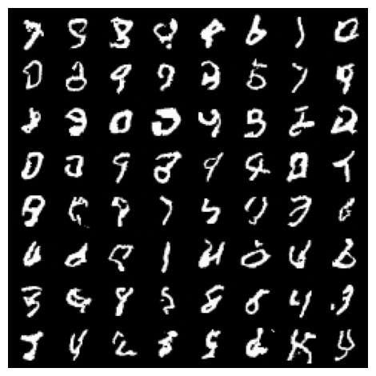
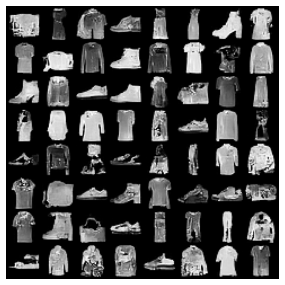
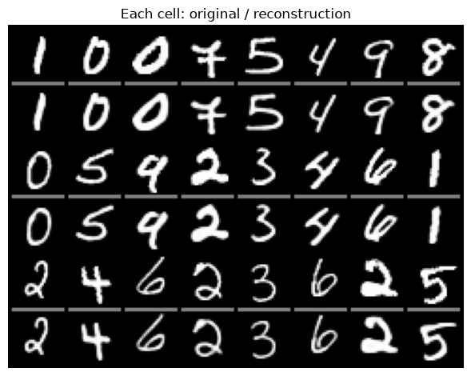
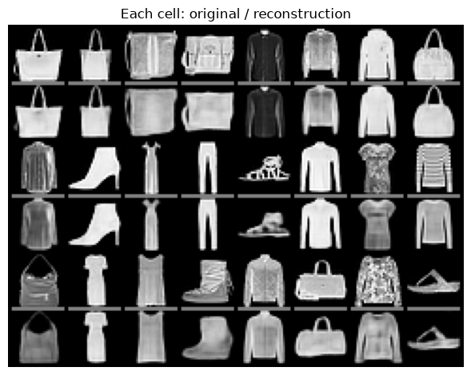
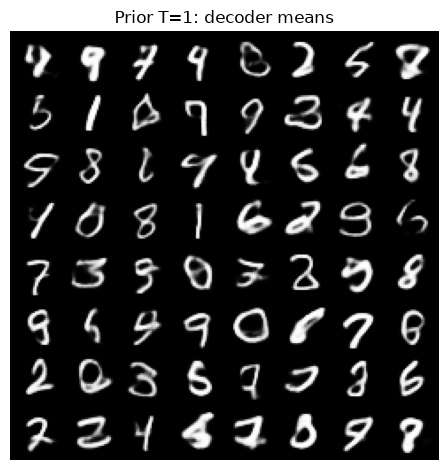
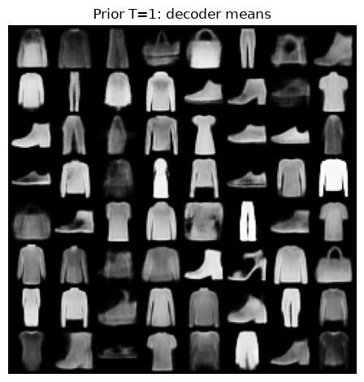
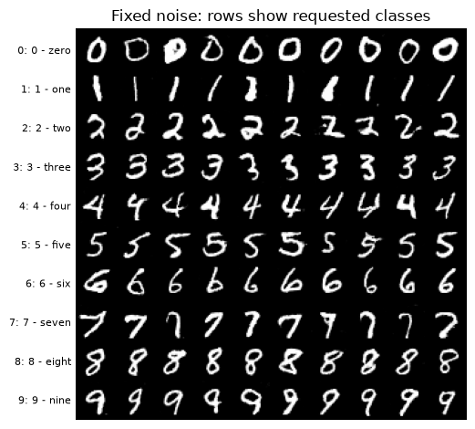
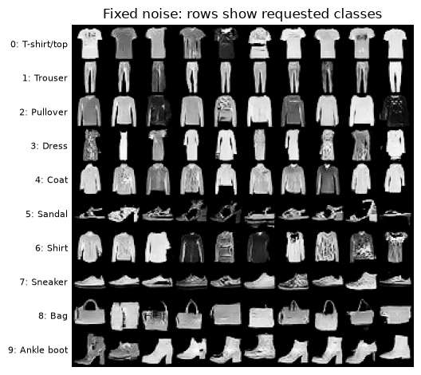

# Generative Models Reports

This document summarizes the three generative modeling assignments on MNIST Digits and Fashion-MNIST. Assignment requirements are condensed from [readme.md](readme.md); detailed experiments, training curves, and additional figures are available in the linked reports.

## Normalizing Flows — 5 pt.

> **Task: Implement and evaluate RealNVP on MNIST datasets.**
>
> - Build RealNVP for grayscale MNIST Digits and Fashion-MNIST using coupling layers and a multi-scale architecture.
> - Implement training, validation, and final test evaluation.
> - Generate images by inverting the flow.
> - Experiment with hyperparameters and architecture to improve likelihood and sample quality.

**Implementation and results.** Implemented multi-scale RealNVP and compared **23 runs** with different widths, coupling counts, conditioner depths, batch sizes, learning rates, and scale limits. The selected **W128/C8/D5, scale-limit-1** models achieved **1.0685 test BPD** on Digits (epoch 28) and **2.8643 test BPD** on Fashion-MNIST (epoch 27). Deeper five-convolution conditioners improved likelihood and the coherence of generated shapes; ambiguous or malformed examples remain.

[**Full Normalizing Flows report**](homeworks/01_normalizing_flows/report.md)

**Selected generations** — five-convolution RealNVP, W128/C8, scale limit 1.

| MNIST Digits — epoch 28 | Fashion-MNIST — epoch 27 |
| --- | --- |
|  |  |

## Autoencoders and VAE — 10 pt. (+2 pt. optional)

> **Task: Autoencoder compression.**
>
> - Implement an autoencoder for the MNIST datasets and train it to compress and reconstruct images.
> - Compare latent sizes using reconstruction error and sample reconstructions.
>
> **Task: Variational Autoencoder (VAE).**
>
> - Implement and train a VAE on Digits and Fashion-MNIST, evaluating reconstruction quality and likelihood.
> - Generate samples from the latent prior and compare the two datasets.
>
> **Task: Flow-based VAE (f-VAE).**
>
> - Combine a VAE with RealNVP transformations in the latent posterior.
> - Evaluate reconstruction quality and likelihood, and visualize generated samples.
>
> **Optional bonus: β-VAE exploration (+2 pt.).**
>
> - Vary the KL-divergence weight β to study disentanglement, reconstruction quality, and generation diversity.
> - Visualize changes caused by traversing individual latent dimensions.

**Implementation and results.** Completed **42 runs** across AE, VAE, f-VAE, and β experiments. The best selected AEs used a **64-dimensional latent space**, achieving **0.001733 test MSE** on Digits and **0.004841** on Fashion-MNIST. VAEs were evaluated with Bernoulli and Gaussian observations; RealNVP coupling layers were added to the VAE posterior. The selected f-VAE improved the Digits test negative ELBO relative to the selected plain VAE (**90.0439 vs. 90.6115**) but did not improve it on Fashion-MNIST (**233.5651 vs. 233.4992**); these selected models have different image backbones, so the comparisons do not isolate the effect of flows. Increasing β reduced KL divergence but worsened reconstruction, without establishing improved disentanglement.

[**Full Autoencoders and VAE report**](homeworks/02_vae/report.md)

**Selected AE reconstructions** — Z64/C32/H256/D1.

| MNIST Digits — epoch 29 | Fashion-MNIST — epoch 28 |
| --- | --- |
|  |  |

**Selected f-VAE generations** — Z32/C32/H256/D1, F4/FH64, β=1.

| MNIST Digits | Fashion-MNIST |
| --- | --- |
|  |  |

## Generative Adversarial Networks — 10 pt. (+2 pt. optional)

> **Task: Vanilla GAN.**
>
> - Implement a generator and discriminator and train them on MNIST Digits and Fashion-MNIST.
> - Track generator/discriminator losses, inspect generated samples, and check for mode collapse.
>
> **Task: Conditional and advanced GANs.**
>
> - Implement class-conditional generation (cGAN).
> - Experiment with a PatchGAN discriminator and feature-matching loss.
> - Compare generation quality and diversity across the variants.
>
> **Optional bonus: Progressive GAN (+2 pt.).**
>
> - Progressively increase resolution while training a GAN on CIFAR-10, and visualize generations at different stages.

**Implementation and results.** Trained vanilla GANs and cGANs, tuning generator/discriminator widths and learning rates. Selected paired checkpoints using **classifier-feature KID-style MMD** rather than generator or discriminator loss alone. The best global cGAN references (**G256/D64**) achieved validation KID-style scores of **0.2803** on Digits (epoch 60) and **1.3987** on Fashion-MNIST (epoch 56), with requested-label agreement of **99.20%** and **91.86%**, respectively. Class conditioning substantially improved results in the matched experiments; feature matching gave small gains at 30 epochs, while PatchGAN caused severe within-class mode collapse on Digits. **The optional Progressive GAN was not implemented.** KID-style scores use dataset-specific classifiers and are not directly comparable across datasets or with standard Inception KID.

[**Full GAN report**](homeworks/03_gan/report.md)

**Selected class-conditional generations** — global cGAN, G256/D64. Each grid contains 10 generated examples for each of the 10 requested classes.

| MNIST Digits — epoch 60 | Fashion-MNIST — epoch 56 |
| --- | --- |
|  |  |
